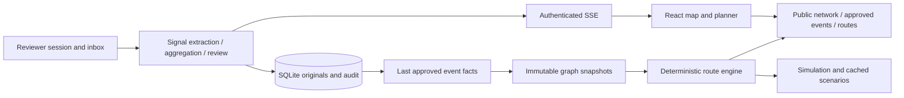
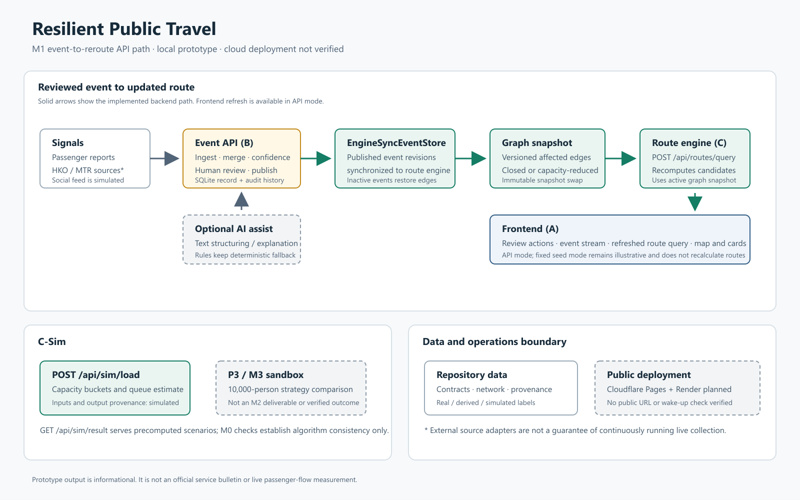

# Resilient Public Travel

ResilientRoute is an academic transit-disruption prototype by **Thirteen Points** for Hong Kong's East Rail corridor, Tai Wai → Admiralty. It combines unverified reports, human-reviewed events, a deterministic route engine and a map. It does not provide official emergency advice or a live timetable.

## What is available

- React map and journey planner with alternative-route cards, ETA ranges, score factors, warnings, provenance and source age.
- Public report submission; reviewer inbox; text-to-draft extraction; manual first-card creation; evidence aggregation; approve, edit, reject and withdraw actions.
- Persistent SQLite signals/events and append-only reviewer audit history.
- Header-authenticated event streaming with reconnect cursors, plus three-second polling. Public journey planning and approved-event reads require no reviewer credential.
- Immutable graph snapshots and route recomputation using **last approved facts**. An edit stays private until approval; the previous approved impact remains active. Rejecting an edited card or withdrawing it removes that impact.
- Simulation backend and precomputed scenario results. The frontend simulation dashboard and side-by-side persona comparison remain later work.
- Offline rule extraction and deterministic AI backend replies. The visible Agent panel currently uses local templates; it is not connected to live AI chat.

## Run locally

Requirements: Python 3.11+ and Node.js 20.19+ or 22.12+. Git is needed to clone. Existing `.venv` and `frontend/node_modules` directories may be reused.

From PowerShell, start the API:

```powershell
git clone https://github.com/Thirteen-Points/resilient-public-travel.git
cd resilient-public-travel
git switch main
python -m venv .venv
.\.venv\Scripts\python.exe -m pip install -r backend/requirements.txt
$env:AI_ENABLED = 'false'
$env:OFFLINE_MODE = 'true'
.\.venv\Scripts\python.exe -m uvicorn backend.app.main:app --host 127.0.0.1 --port 8000
```

In a second terminal, from the repository root:

```powershell
cd frontend
npm ci
npm run dev
```

Open [the frontend](http://localhost:5173). The default API URL is `http://127.0.0.1:8000`. The API exposes [interactive endpoint documentation](http://127.0.0.1:8000/docs). On Linux/macOS, replace `.venv\Scripts\python.exe` with `.venv/bin/python` and set environment variables using `export`.

To configure a different API, set only the public endpoint in `frontend/.env.local`:

```dotenv
VITE_API_BASE_URL=http://127.0.0.1:8000
```

Restart Vite after configuration changes. For a deployed frontend, use an HTTPS API and set `CORS_ALLOWED_ORIGINS` on the server to the exact frontend origins, separated by commas. A public deployment has not been verified by the local regression.

### Optional reviewer access for a controlled local demo

Before starting the API, set a fresh temporary `REVIEW_API_TOKEN` in the server terminal. For example, generate one locally:

```powershell
$env:REVIEW_API_TOKEN = .\.venv\Scripts\python.exe -c "import secrets; print(secrets.token_urlsafe(32))"
```

Keep that terminal available. Enter its temporary value into **Review → Temporary credential → Connect reviewer**. The UI holds it in memory and sends it in `X-Review-Token`; disconnect and reload clear the browser credential. It is never placed in a URL, browser storage or a Vite build variable. Never configure `VITE_REVIEW_TOKEN`.

This shared-token access is for a controlled demo. A production deployment needs reviewer identity/session authentication or a trusted proxy that keeps the service credential on the server. CORS does not authenticate reviewers. Without a configured server token, protected endpoints return 503; missing/incorrect authorization returns 401. Public queries and reports continue to work.

### Two explicit data modes

- **API mode** (default): local modelled network, current approved facts and deterministic route calculations. Network/route policies contain simulated assumptions; API mode does not imply live or verified transport data.
- **Fixed seed demo**: open `http://localhost:5173/?data=seed`. Only the fixture OD is supported; preference changes reorder fixed routes. Review decisions are local and do not recalculate fixture routes. Dates do not turn the fixture into a live timetable.

API failures preserve already loaded data with a stale notice; they do not silently switch to seed mode. With no previous successful data, the page offers retry and an explicit seed-mode switch. The seed demo must be loaded before disconnecting; it is not an installed offline PWA. Basemap failures leave schematic network overlays visible.

## Reproduce the event workflow

1. In **Report**, submit a supported East Rail disruption description. HTTP 202 means receipt of an unverified Signal, not event publication.
2. Connect a reviewer in **Review**, refresh **Unlinked reports**, and choose **Extract / merge**.
3. If there is no reliable existing match, confirm the draft, severity, affected segments, capacity factors and HKT time window; choose **Create pending card**. A closed segment requires an explicit capacity factor of 0. Extraction never invents these numeric facts.
4. Ingest corroborating reports into the matching card. The server recalculates confidence; identical/anonymous sources do not automatically count as independent. A card below 0.55 cannot reach the 0.60 publication threshold with the 0.05 human-confirmation bonus.
5. Choose **Publish → Confirm publication**. An approved event affects the graph and current route query within its time window. The map and graph read the same last-approved event revision at the query's departure time.
6. Edit a published card and save: its reviewer status becomes `updated`. The previous approved facts remain public. Reapprove to replace them, or **Withdraw event** to remove the impact. Rejecting an updated card also removes the previous impact.

A deterministic rule extracts only supported station spans and categories. Unsupported or ambiguous reports require manual review. User-input provenance `real` describes the channel; it does not verify the content. Scripted tests and seed scenarios are not live incidents. The UI's rejection note is session-local; the server audits the rejection action, not that note.

For databases predating approved-revision storage, current `published` cards migrate automatically. An old `updated` card has no reconstructible approved payload and must be reviewed again. Expired time windows stop affecting routes and maps without a reviewer click; explicit withdrawal also removes the saved approval.

## API surface

| Method | Endpoint | Access / purpose |
|---|---|---|
| GET | `/api/health`, `/api/health/deep`, `/api/meta` | Public readiness and source metadata |
| GET | `/api/graph/network` | Public modelled network |
| GET | `/api/graph/snapshot?at=<ISO time>` | Public graph impact at a timezone-aware instant; current time by default |
| POST | `/api/routes/query` | Public deterministic route candidates |
| POST | `/api/signals` | Public unverified report intake |
| GET | `/api/events/published?at=<ISO time>` | Public last-approved events effective at that instant |
| GET | `/api/signals`, `/api/signals/{id}` | Reviewer originals; `unlinked_only=true` supported |
| GET | `/api/events`, `/api/events/{id}`, `/api/events/{id}/signals` | Reviewer queue and evidence |
| POST | `/api/events/ingest`, `/api/events` | Reviewer draft/merge and complete pending-card creation |
| POST | `/api/events/{id}/review` | Reviewer `approve`, `edit` with `edits`, `reject`, `expire` |
| GET | `/api/stream/events` | Reviewer SSE; `X-Review-Token`, `Last-Event-ID` or `after_id`; no URL credentials |
| POST | `/api/sim/load` | Public modelled diversion plan |
| GET | `/api/sim/result?scenario_id=...` | Public precomputed simulation |
| POST | `/api/ai/chat` | Public deterministic backend tool reply; not wired to the visible Agent panel |

Route-query example:

```json
{"origin":"TAW","destination":"ADM","depart_at":"2026-09-30T18:30:00+08:00","profile":{"preset":"fastest"}}
```

## Architecture and data boundaries



Every record carries `real`, `real-derived` or `simulated` provenance. Unknown station accessibility stays `null`, never `true`. A general map pick may select such a station while explicitly requiring accessibility verification; it does not certify wheelchair access. Route-leg accessibility may still reflect model assumptions, as stated in route warnings.

The event AI adapter is optional (`AI_ENABLED`, provider-specific `DEEPSEEK_`, `QWEN_` or `GLM_` configuration; see `.env.example`). Schema validation and deterministic fallback do not prove factual accuracy. AI extraction is limited to categorical/text fields; routing numbers, confidence, capacity and simulation metrics come from code, traceable data or explicit reviewer inputs. No live model acceptance or HKO/MTR polling verification is claimed here. External-source poller modules exist but are not automatically scheduled by the default application.

See [provenance](data/PROVENANCE.md), [data quality](data/DATA_QUALITY.md), [contracts](contracts/README.md), [frontend guide](frontend/README.md) and [current M2 integration notes](frontend/M2-INTEGRATION.md).

## Verification

```powershell
cd frontend
npm run typecheck
npm run test
npm run build
cd ..
$env:PYTHONPATH = Join-Path (Get-Location) 'backend'
.\.venv\Scripts\python.exe -m unittest discover -s backend/tests -q
.\.venv\Scripts\python.exe -m pytest backend/app/engine/tests tests/cross_module -q
```

Install `backend/requirements-dev.txt` when pytest is missing. For the isolated browser regression, provide an installed Playwright module via `M2_PLAYWRIGHT` (or install it separately), and optionally use an installed Edge with `M2_BROWSER_CHANNEL=msedge`:

```powershell
$env:M2_BROWSER_CHANNEL = 'msedge'
node tests/browser/m2.e2e.cjs
```

The browser test starts temporary API/database and Vite processes, uses visibly scripted reports, and writes screenshots/results under `.cache/m2-browser/`. Its test credential is not a production secret. The test closes its processes afterward. No API keys are required.

## Simulation scope and interim deliverables

The 10,000-person multi-OD sandbox belongs to P3/M3 in the project timeline. Files named `data/sim/m2-*` are early simulated preparation, not M2 interim acceptance evidence. Guided total delay is higher than baseline in the current comparison; the simulated result does not show a benefit. Route-level capacities do not account for shared capacity across overlapping segments.

C-Sim includes sequential journey timeline simulation and contract validation for checked-in seeds. See [simulation data](data/sim/README.md), [M2 C-side status](docs/acceptance/m2-c-status.md), [interim progress report](docs/submissions/m2-progress-report.md), [data and AI usage](docs/submissions/data-and-ai-usage.md), and [demo shot list](docs/coordination/M2-3-minute-demo-shotlist.md).



The [editable architecture SVG](docs/architecture/resilient-public-travel.svg) documents the event-to-route flow, optional AI assistance and separately scoped simulation work. The frontend is available at [resilient-public-travel.pages.dev](https://resilient-public-travel.pages.dev/). Render API deployment and the frontend-to-API connection remain unverified. The Render Blueprint and health-ping workflow require service creation and the repository variable `RENDER_API_URL`. See [deployment instructions](deploy/DEPLOYMENT.md).
