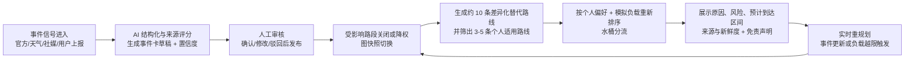

# 01 产品定义与范围（Product Definition & Scope）

> 本文档定义"做什么、给谁、边界在哪、怎么算成功"。**范围一旦冻结（9/24），任何扩大都要走 `04-workstreams.md` 的变更流程。**

---

## 1. 一句话定义

**当港铁东铁线"大围 → 金钟"走廊的某个区段中断或运力骤降时，本平台把多源信号变成可信事件、把事件变成替代路线、再按"个人偏好 + 群体运力"把乘客重新分配到地铁 / 巴士 / 小巴 / 步行 / 渡轮的组合上。**

工作名：**ResilientRoute**（暂定，A 可在 9/24 前改名并统一到 README、PPT、UI）。

电梯演讲（英文，用于提交材料，A 负责润色）：

> When the East Rail Line breaks between Tai Wai and Admiralty, commuters are left with fragmented information and no personalised alternative. ResilientRoute turns noisy signals — official notices, weather warnings, social posts, user reports — into a human-verified disruption event, then instantly rebuilds cross-modal alternatives (MTR, bus, minibus, walking, ferry) that respect each traveller's own trade-off between time, transfers, walking, fare, comfort and carbon — and spreads the crowd across routes instead of dumping everyone onto the same one.

---

## 2. 问题：为什么这件事值得做

### 2.1 走廊本身是香港交通的"单点故障"

| 事实 | 数值 / 说明 |
|---|---|
| 走廊站点 | 大围 TAW → 九龙塘 KOT → 旺角东 MKK → 红磡 HUH → **会展 EXC** → 金钟 ADM（6 站 5 段） |
| 过海段通车 | 2022-05-15 东铁过海段通车，大围→金钟直达约 **17 分钟**，比旧路径快约 11 分钟 |
| 结构性弱点 | **会展站是东铁线独有车站**，没有任何其他重铁线路接驳 → 一旦过海段中断，会展站只能靠巴士 / 步行 |
| 单列车运力 | 9 卡编组，定员约 **2,845 人**（6 人/m²，立法会二手来源，未核实）≈ **20 辆双层巴士**（约 137 人/辆，业界估算，未核实）——**推导示意，非运营测量**；4 人/m² 密度下约 15 倍 |
| 高峰班距 | 2.7–5.5 分钟（金钟↔上水），单向实际约 **6 万人次/小时** |

### 2.2 替代运力远小于被中断的运力（这是本项目的核心矛盾）

调研只有**单次网络检索**的"982X 早高峰载客率 >90%"（**未持续监测、未核实**；985B"第三个站近七成满"同为单次检索说法）。即便不依赖该未核实数字，仅按可推导的运力等级（`data/capacity_method.md` §4）：

> **风险口径（替代"物理上不成立"的绝对断言）**：一列东铁的定员约等于 15–21 辆双层巴士（推导示意，随密度假设浮动），而模型化过海巴士供给（182 ≈466 人/时按估算班距；982X ≈559/≈873 人/时为截图时段推导示意）比东铁小时运力低 **1–2 个数量级**。因此把东铁高峰客流**整体**导向既有过海巴士，在模型中会留下大量未满足需求（仿真字段 `unstoppable_demand`）——这是**运力缺口风险**，不是已证实的运营事实。

所以真正的韧性方案必须是四件事的组合，这也正是本产品的立意：

1. **多模式绕行**：把人导向还有余量的轨道（屯马线 TML / 观塘线 KTL / 荃湾线 TWL / 港岛线 ISL）+ 步行换乘 + 天星小轮；
2. **就近接入**：避免所有人涌向同一个巴士站，按 800 米步行圈分配接入点；
3. **错峰与预期管理**：明确告知"预计需要等 N 班车"，给出出发时间建议，而不是假装有票；
4. **个人不同策略**：赶时间的人走快但拥挤的路线，轮椅用户走全无障碍但慢的路线。

### 2.3 信息侧的问题

中断发生时，乘客面对的是碎片化信息（官方公告、社媒、群组消息、站内广播），没有"把噪声变成可信事件"的机制，也没有任何工具回答"**以我的情况，现在应该怎么走**"。

---

## 3. 场景定义（Scenario Spec）

| 维度 | 定义 |
|---|---|
| **空间** | 走廊六站（TAW / KOT / MKK / HUH / EXC / ADM）各自的 **800 米步行圈**。起点＝走廊内任一站步行圈内的任意地点；终点＝另一个走廊站步行圈内的任意地点 |
| **时间** | 用户指定的日期 + 时间（工作日 / 周六 / 周日及公众假期使用不同时刻表 → 必须支持"真实服务日历"） |
| **触发** | 东铁线一段或多段不可用，或运力大幅下降 |
| **硬约束** | **不使用受影响的东铁出行**（受影响区段在图上是关闭或被降权） |
| **决策依据** | 真实服务日历、方向、站序、班次、天气、价格、舒适度、总时间、碳排放、数据新鲜度 |
| **输出** | ①约 10 条差异化替代路线（系统级）；②3–5 条适用于个人偏好的路线（含排序、原因、风险、预计到达区间） |

### 两个必须能演的 Situation

**Situation 1 — 人在站内，已经知道延误，很急**
> 上班族在中环上班，早上 8:15 走到大围站闸机前，手机弹出事件卡"红磡—会展过海段信号故障，东铁过海段暂停"。他打开网页 → **上报**（"我在大围站，看到广播说延误"）→ 系统把他的上报并入已有事件（置信度上升）→ 立刻按他"赶时间"的画像给出 3 条替代路线，第一条是"屯马线到尖东 → 站内步行到尖沙咀 → 荃湾线过海 → 金钟"，预计 31–38 分钟，并标注"比平时多 15–20 分钟，但比在站内等待快"。

**Situation 2 — 人还没进站，提前知道**
> 用户打算从大围去红磡，出门前在网页上输入起终点，系统已经因为事件把东铁段关闭，直接给出替代方案（屯马线直达红磡，约 17 分钟），并提示"原东铁方案不可用，原因：MH 站信号故障（港铁公告 + 2 条社媒 + 1 条用户上报，置信度 0.8，已人工确认，08:12 发布）"。

---

## 4. 用户（Who）

| 画像 | 关键差异 | 对系统的影响 |
|---|---|---|
| 赶时间的上班族 | 时间权重最高，能接受拥挤与多换乘 | 首选不同的路线与"赶时间"预设 |
| 学生 | 价格敏感，时间容忍度高 | 便宜优先（分段票、$6 分段 982X） |
| 游客 | 不熟路、怕换乘、行李 | 换乘数权重高，提示"哪个出口 / 哪条通道" |
| 长者 | 慢步速、怕楼梯、少站立 | 步速 0.8 m/s、换乘偏好电梯 |
| **轮椅使用者** | **硬约束**：只用低地台车辆与无障碍换乘 | 排除小巴（全港仅 4 辆低地台且不在沙田）、排除阶梯换乘、步行上限 400 米 |

> 说明：同一事件下，**"赶时间用户"和"轮椅用户"必须看到不同的首选路线**——这是"懂个人"的验收画面。

---

## 5. 三个亮点 → 对应模块 → Demo 必须看到的画面

| 亮点 | 能力 | 负责模块 | Demo 必须看到的画面 | 验收指标（见 `07`） |
|---|---|---|---|---|
| **早发现** | 多源信号（官方 / 气象 / 社媒 / 用户上报）→ 事件聚合 → 置信度 → 人工审核发布 | B（事件管道 + 审核台） | 一条非结构化文本进入 → 变成结构化事件卡；置信度由低到高爬升（0.2 → 0.55 → 0.9）；审核员点"发布"后地图上受影响区段变红/变灰，路线卡片自动重算 | 从注入文本到事件卡出现 ≤ 30 秒；置信度提升可复现；发布到地图变色 ≤ 5 秒 |
| **懂个人** | AI 偏好转权重、多路线、可解释推荐 | B（画像）+ C（打分）+ A（对比视图） | 同一事件、同一 OD，切换"赶时间上班族"与"轮椅用户"→ 首选路线不同，权重条与解释文案不同，不符合偏好的路线带备注（如"步行偏多 650 米"） | 两个画像的首选路线必须不同；每条路线有 ≥ 3 条打分维度可见；备注规则命中 |
| **会分流** | 群体负载预测、比例推荐、实时重规划 | C（仿真 + 水桶）+ A（看板） | 1 万人沙盒：无引导时全部挤向同一路线 → 该路线过载（load factor > 1）、总延误飙升；有引导时被分配到 A/B/C，过载消失、总延误下降，并诚实地显示"仍有 X 人/小时的运力缺口"（**仿真输出，非实测**） | 有引导 vs 无引导的总延误（人·分钟）对比图可见；过载线路数从 ≥1 降到 0；缺口数字不为零（诚实性） |

---

## 6. 端到端流水线（产品视角）

每个阶段的输入 / 输出 / 负责人 / 延迟预算见 `02-architecture.md` 第 2 节。

---

## 7. MVP 边界（In Scope）

- **空间愿景**：AI 赋能的公共交通韧性平台。
- **实际试点**：东铁线**一个中断区段**（默认演示场景：红磡 → 会展过海段）及其跨模式替代网络，覆盖走廊六站 800 米步行圈。
- **交通方式**：港铁 + 巴士（含过海专营巴士）+ 步行换乘；小巴与天星小轮作为**可选腿**（小巴仅对非轮椅用户开放）。
- **事件来源**：官方 / 气象（真实可编程来源）+ 社媒流（**模拟但标注清楚**）+ 用户上报（真实）。
- **用户偏好**：最快 / 最稳定 / 少换乘三种预设（各自对应一组权重），可再用自由文本微调；**不做历史行为学习**。
- **群体分流**：可解释的容量阈值 + 负载模拟；**不宣称实现真实城市级调度**。
- **规模**：走廊网络约 20–40 节点 / 10–20 条线路；沙盒 10,000 人。

## 8. 明确不做（Out of Scope，写进 PPT 的"诚实边界"）

- ❌ 不构建全港所有线路的实时数字孪生（只做走廊 + 与走廊相连的替代线）。
- ❌ 不训练自有大模型，不做复杂多模态识别（不做图像/视频识别）。
- ❌ 不宣称路线是官方应急指引；界面**必须**显示信息来源、更新时间与免责声明。
- ❌ 不做真实支付、不做实时定位追踪个人位置、不做历史行为画像与推荐学习。
- ❌ 不承诺与港铁 / 运输署系统对接（无官方 API 可对接，见 `08`）。
- ❌ 不做巴士实时到站级别的班次预测（无车辆载客量数据，见 `08` §3）。

## 9. 成功标准（可测 — 10/18 交付时逐条打分）

| # | 标准 | 判定方式 |
|---|---|---|
| S1 | 一条非结构化文本 → 事件卡 → 审核发布 → 地图变色 → 路线重算，全链路可连续跑通 | 现场演示，无人工后台干预（除点击"发布"） |
| S2 | 同一事件下至少两个画像的首选路线不同，且解释可读 | 屏幕对比 + 录屏 |
| S3 | 1 万人沙盒给出"有引导 vs 无引导"的量化对比，且缺口数字诚实呈现 | 图表 + 数字 |
| S4 | 所有线路/班次/票价标为"真实"的数据**可溯源到出处**；模拟数据**逐条标注** | 抽查 `08` 附录 + UI 徽标 |
| S5 | 全站每个推荐结果都带来源、更新时间、免责声明 | UI 检查 |
| S6 | 10/18 交付物齐备：可访问的网址 + 3 分钟演示视频 + PPT + README（英文） | 打包清单（`05` §3） |

> **反面标准（避免自欺）**：如果仿真模型显示"分流后总延误没有下降"，**不允许改数字**。改为报告"在何种条件下分流有效 / 无效"（例如需求超过总运力时只能减少浪费、不能消除延误）——这是产品诚实性的一部分，也是评委会问的点。

## 10. 泛化叙事（用于结尾升华，控制在 1 页）

> 我们只做了大围—金钟一段，但引擎与数据是解耦的：**换一份网络数据 + 换一份事件源，同一套"事件 → 降权 → 多模式重算 → 个性化 → 分流"的流水线就能搬到其他走廊**——其他轨道交通区段中断、某条主干道发生大型交通事故后的公交绕行、甚至台风期间的出行预案。我们交付的是一套**可复用的韧性方法论和一个可运行的示范**，而不是一条写死的应急线路。
