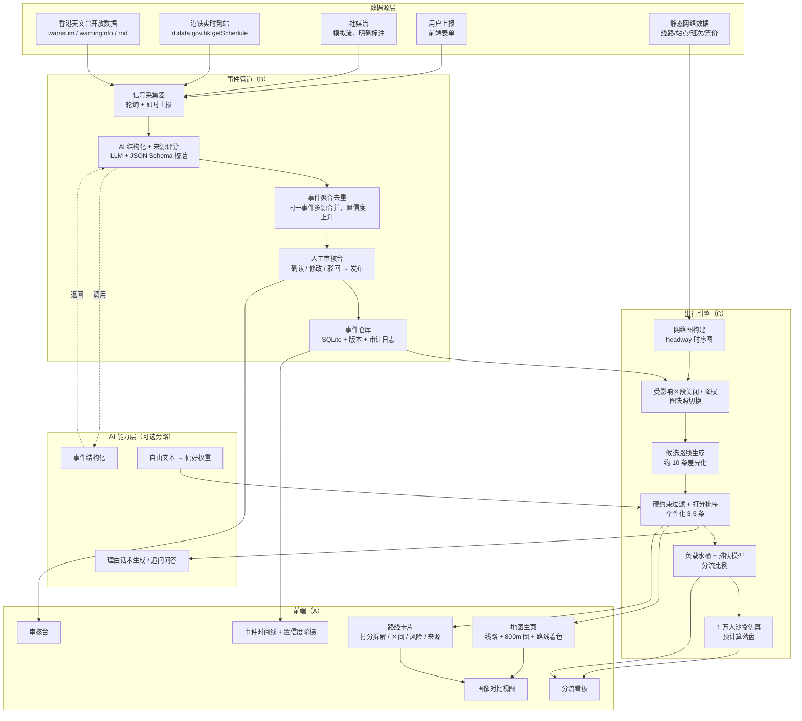

# 02 系统架构与算法（Architecture, Pipeline & Models）

> 读完本文你应该能回答：系统由哪几块组成、每块的负责人是谁、数据怎么流、**AI 到底用在哪、哪里坚决不用 AI**、路线怎么打分、分流怎么做。

---

## 1. 架构总览



**关键设计原则**：AI（橙色旁路）**不在数据主链路上**。任何 AI 失败，系统降级为确定性规则，主流程照常跑通（见 §5）。

---

## 2. 六阶段流水线（含延迟预算）

| # | 阶段 | 输入 | 输出 | 负责 | 技术 | 延迟预算 |
|---|---|---|---|---|---|---|
| 1 | 事件信号进入 | 官方/天气轮询（60–120 s）、社媒模拟流、用户上报 | 原始信号 `Signal[]` | B | FastAPI 定时任务 + 上报端点 | 轮询 60–120 s；上报 < 1 s |
| 2 | AI 结构化与来源评分 | 原始信号文本 | 事件卡草稿 + 置信度 + 因子拆解 | B | LLM（JSON 结构化输出）+ Schema 校验 + 规则兜底 | P95 ≤ 8 s |
| 3 | 审核发布 | 事件卡草稿 | `status=published` 的事件（人工点击，可编辑） | B | 审核台 UI + 发布端点 | 人工目标 ≤ 60 s（Demo 演 10–20 s） |
| 4 | 受影响路段关闭/降权 | 已发布事件 | 新的图快照（边 `capacity_factor` 变化） | C | 图快照版本切换（内存 + 落盘） | 发布后 ≤ 2 s |
| 5 | 生成候选 + 个性化 | OD + 时间 + 画像 + 图快照 | 10 条候选 + 3–5 条个人路线（含打分与解释） | C | headway 时序图 + 多目标 k-最短（多样性约束） | P95 ≤ 1.5 s |
| 6 | 负载重排 + 展示 | 候选路线 + 需求量 | 分流比例、每路线负载、原因、风险、到达区间 | C + A | 水桶算法 + 排队等待近似 + 预计算仿真 | P95 ≤ 300 ms（仿真结果预计算落盘） |

**从"点发布"到"地图变色 + 卡片刷新"总预算 ≤ 5 秒**——这是 Demo 的核心观感指标。

**实时重规划触发条件**（对应产品第四步反馈环）：
- 事件被更新 / 新增 / 撤销（置信度跨过阈值）；
- 某路线 `load_factor > 0.95` 持续 5 分钟；
- 天气警告变化（黑雨 / 八号风球）。

触发后：重算 → 前端顶部横幅提示"路线已更新：因为……" → 受影响用户路线高亮变化。

---

## 3. 模块清单与责任矩阵

| 模块 | 一句话职责 | 负责人 | 产出（目录） | 主要接口 |
|---|---|---|---|---|
| M1 信号采集 | 轮询官方/天气源、接社媒模拟流、接用户上报 | **B** | `backend/app/services/ingest/` | `POST /api/signals`，内部轮询器 |
| M2 事件结构化 | 文本 → 结构化事件卡 + 来源评分 | **B** | `backend/app/services/structure/` | `POST /api/events/ingest` |
| M3 事件聚合与置信度 | 多源合并、去重、置信度阶梯 | **B** | `backend/app/services/confidence.py` | `GET /api/events` |
| M4 审核与发布 | 待审队列、编辑、驳回、发布、审计 | **B**（A 做界面） | `backend/app/api/review.py` + `frontend/src/pages/AdminConsole` | `POST /api/events/{id}/review` |
| M5 网络图构建 | 由静态数据构建 headway 时序图与快照 | **C** | `backend/app/graph/` | `GET /api/graph/network` |
| M6 路线引擎 | 候选生成、硬约束过滤、打分、解释 | **C** | `backend/app/engine/` | `POST /api/routes/query` |
| M7 负载与分流 | 容量水桶、排队等待、分流比例、公平约束 | **C** | `backend/app/engine/load.py` | `POST /api/sim/load` |
| M8 沙盒仿真 | 1 万人、有/无引导对比、指标输出 | **C** | `backend/app/sim/` | `POST /api/sim/run`（离线）+ `GET /api/sim/result` |
| M9 画像服务 | 画像库、预设权重、自由文本 → 权重 | **B** | `backend/app/services/persona.py` | `GET /api/personas`, `POST /api/persona/parse` |
| M10 AI 工具层 | 把引擎能力暴露为 LLM 可调用的函数 | **C**（B 定 schema） | `backend/app/ai/tools.py` | 见 §6 |
| M11 地图与可视化 | 底图、图层、路线着色、动画 | **A** | `frontend/src/pages/MapView` | 消费 M5–M8 |
| M12 卡片与解释 UI | 打分拆解、区间、风险、来源徽标 | **A** | `frontend/src/components/RouteCard` | 消费 M6 |
| M13 数据真实性标注 | 每个字段的 `provenance` + 新鲜度徽标 | **A**（B 定规则） | `frontend/src/components/Provenance` | 消费 `meta` 字段 |
| M14 部署与运维 | 静态站点 + API 部署、保活、缓存落盘 | **C**（A 配合前端域名） | `deploy/` | — |

---

## 4. 技术选型（结论已按调研核实）

| 层 | 选型 | 一句话理由 | 备选 / 降级链 |
|---|---|---|---|
| 前端框架 | **Vite + React + TypeScript** | 3 人分工下组件化最省心，A 可独立开发 | 纯 JS（若 A 不适应 TS） |
| 地图 | **Leaflet 1.9** | 插件最厚（画线、动画、颜色切换），新手友好；本场景节点数极少 | MapLibre GL JS（想更好看时） |
| 底图 | **CARTO Positron（免费 key）→ OpenFreeMap → OSM 标准瓦片（合规 UA）** | 代码内写死降级链，防止演示当天被限流 | MapTiler（仅非商用） |
| 后端 | **Python 3.12 + FastAPI（单进程）** | 与算法同语言、同进程跑图算法，零额外服务 | — |
| 数据库 | **SQLite（随仓库文件）** | 数据量极小，零运维；事件仓库 + 审计日志表 | 内存 + JSON 落盘 |
| 图算法 | **networkx + 自建 headway 时序图** | 20–40 节点规模下毫秒级出解；代价函数完全自定义（步速/轮椅/换乘惩罚/票价敏感/拥挤度）—— 这正是本项目差异化的地方 | OpenTripPlanner（能力过剩，4 周吃不消） |
| 步行接驳 | **离线一次性算好步行耗时矩阵**（直线距离 × 绕行系数 ÷ 步速；有余力再用 OSRM 算真实几何） | 拿到真实感但不背 OSRM 运维 | 纯直线距离（最粗糙，Demo 可接受） |
| 仿真 | **纯 Python 离散时间步 + 队列分配**（不需真跑 1 万个 agent） | 1 万人按 OD 对做比例分配即可；结果预计算落盘 | Mesa（不必要） |
| 事件源 | **HKO `warnsum`/`warningInfo`（真实）+ MTR `getSchedule.php` 异常检测（真实）+ 社媒模拟流 + 用户上报** | 无鉴权、零法律风险、真实可编程 | 人工注入（演示兜底，永远保留） |
| LLM | **DeepSeek `deepseek-v4-flash` 主 + Qwen `qwen3.7-flash` 兜底 + GLM `glm-4.5-flash` 免费跑高频**，全部 OpenAI 兼容 | 便宜大碗 + 支持 tool calling；**避开 OpenAI/Gemini 的香港地区限制** | 无 LLM：模板话术（必须实现） |
| 部署 | **前端 Cloudflare Pages（带宽不限）+ 后端 Render Free（cron 保活）** | 全免费，香港可达；Vercel Hobby 禁止商用 | 本地 + 录屏（演示兜底） |
| 版本管理 | Git + PR（1 人 review）+ `main` 永远可跑 | 三人并行唯一的可行方式 | — |

> 详细出处、价格与限流规则见 `08-data-appendix.md`。

---

## 5. AI 边界（写进 PPT 的一页）

### 5.1 交给 AI 的三件事

| 用途 | 输入 | 输出 | 为什么适合 AI |
|---|---|---|---|
| **A. 事件结构化** | 一段非结构化文本（公告 / 社媒 / 用户描述） | 严格 JSON：事件类型、线路、方向、区段、严重度、时间窗 + 置信度因子 | 语言理解与抽取，规则写不完 |
| **B. 自由文本 → 偏好权重** | "我妈腿脚不方便，别走太多路，也别太贵" | 画像字段 + 权重建议（含可解释说明） | 自然语言 → 结构化偏好 |
| **C. 解释与追问话术** | 结构化路线 + 打分拆解 | 一段人话解释（"为什么推荐这条 / 为什么不推荐那条"） | 生成可读文案 |

### 5.2 **不**交给 AI 的事（硬规则）

| 硬规则 | 说明 |
|---|---|
| **AI 不产生任何数字** | 时间、票价、班次、容量、负载、延误全部来自确定性引擎；AI 只做"翻译"与"措辞" |
| **AI 不生成路线** | 路线只能由 M6 图算法产出；AI 无权发明站点或线路（防幻觉的关键） |
| **AI 输出必须过 Schema** | 校验失败 → 重试 1 次 → 仍失败 → **降级到规则/模板**，主流程不阻塞 |
| **AI 不在关键路径上** | 全链路最小可用版本必须不依赖 LLM 也能跑（模板话术 + 规则抽取） |
| **不上传隐私** | 不把用户身份/位置上传大模型；只发结构化、去标识的偏好字段 |
| **成本上限** | 每次调用记 token 与费用，总预算上限写在 `.env`；超限自动切免费模型（GLM Flash） |

> **演示必说的一句话**：*"我们没有把系统交给 AI。基础运算用确定性的图算法和队列模型，AI 只负责三件它擅长的事：读懂文本、读懂偏好、说人话。"*

---

## 6. AI 工具层（给 LLM 调用的函数）

后端把引擎能力包装成 function calling 工具，**这是"AI 能调用的接口"落地形态**。

| 工具名 | 签名（简化） | 返回 | 实现者 |
|---|---|---|---|
| `geocode_place` | `(query: str) -> {lat, lng, label}` | 地点坐标 | C（可用静态地名表） |
| `find_access_points` | `(lat, lng, radius_m=800) -> AccessPoint[]` | 可用接入点（站入口/巴士站/码头） | C |
| `get_published_events` | `(line?: str, at?: str) -> Event[]` | 已发布事件卡 | B |
| `search_transit_routes` | `(from, to, depart_at, modes, profile) -> RouteCandidate[10]` | 候选路线 | C |
| `score_routes` | `(route_ids, weights) -> RouteScore[]` | 打分与拆解 | C |
| `estimate_load` | `(route_ids, horizon_min) -> LoadEstimate[]` | 负载与等待班数 | C |
| `get_diversion_plan` | `(event_id, demand) -> DiversionPlan` | 分流比例与指标 | C |
| `parse_user_preference` | `(free_text) -> ProfilePatch` | 画像与权重建议 | B |
| `explain_route` | `(route_id, locale) -> str` | 人话解释 | B（LLM 话术，数字来自引擎） |

**调用纪律**：LLM 只能通过这些工具读数据；工具返回的结构里**每个数字都带 `provenance` 与 `freshness_s`**，UI 上必须显示。

---

## 7. 数据真实性分级（产品诚实性的骨架）

| 等级 | 含义 | 前端徽标 | 举例 |
|---|---|---|---|
| `real` | 来自官方开放数据，可溯源 | 🟢 真实数据 + 来源链接 | 天文台警告、港铁到站、线路与站点、票价、官方班距 |
| `real-derived` | 由真实数据推算 | 🟡 推算值 | 站间行车时间（由班距/距离推算）、巴士运力（车型 × 班次） |
| `simulated` | 参照现实模拟 | 🔵 模拟数据 | 社媒流、拥挤度、实时负载、1 万人需求分布 |

规则：**每一条路线卡片底部必须能展开看到"这条路线里哪些数字是真实的，哪些是模拟的"**（A 实现，B 提供字段）。这一条同时是答辩时的护身符。

---

## 8. 路线打分模型（M6）

### 8.1 第一层：硬约束（过滤，不打分）

| 约束 | 规则 |
|---|---|
| 事件约束 | 受影响的边 `capacity_factor = 0` 时不可通行；`0 < factor < 1` 时按运力缩放并记录惩罚 |
| 无障碍 | `mobility ∈ {reduced, wheelchair}` → 排除阶梯换乘、排除**小巴**（全港仅 4 辆低地台且不在沙田）、排除非低地台巴士、`max_walk ≤ 400 m` |
| 步行上限 | `walk_m ≤ profile.max_walk_m`（默认 800） |
| 换乘上限 | `transfers ≤ profile.max_transfers`（默认 3） |
| 服务日历 | 出发时刻该线路未运营 → 剔除（工作日/周六/周日及公众假期四套时刻表） |
| 数据新鲜度 | `freshness > 阈值` 不剔除，但在卡片上打"数据较旧"警示（诚实而非隐藏） |

### 8.2 第二层：加权打分

```
U(route | user) = Σ_k  w_k(user) · f_k(route)     其中 Σ w_k = 1，f_k ∈ [0,1]
```

| 维度 k | 归一化 f_k | 默认权重（最快 / 最稳 / 少换乘） |
|---|---|---|
| 时间 `time` | `1 − (T_r − T_min) / (T_max − T_min)` | **0.45** / 0.25 / 0.25 |
| 换乘 `transfers` | `1 / (1 + transfers)` | 0.10 / 0.10 / **0.35** |
| 步行 `walk` | `1 − walk_m / max_walk_m` | 0.10 / 0.10 / 0.15 |
| 价格 `price` | `1 − fare / baseline_fare`（基线＝原东铁票价） | 0.10 / 0.05 / 0.05 |
| 舒适度 `comfort` | 座位概率 × 站立时长惩罚 × 拥挤度惩罚 | 0.05 / 0.10 / 0.10 |
| 可靠度 `reliability` | `1 − σ_r / T_r`，σ 按模式经验方差：地铁 0.08T、巴士 0.35T、小巴 0.30T、渡轮 0.25T、步行 0.15T；雨天/大风额外惩罚巴士与渡轮 | 0.10 / **0.35** / 0.05 |
| 碳排放 `carbon` | `1 − co2 / co2_max` | 0.05 / 0.05 / 0.05 |
| 新鲜度 `freshness` | `exp(−age / τ)`，实时数据 τ=15 min，时刻表 τ=6 h | 0.05 / 0.05 / 0.05 |
| 负载（仅分流模式） | `1 − (load_factor / η_max)²`，`η_max = 0.85` | 由分流开关控制 |

### 8.3 输出必须包含（解释性）

- **ETA 区间**：`[p10, p90]`，由 `T_r × (1 ± z·CV)` 计算（CV = σ_r / T_r）——**不给单一数字，给区间**；
- **`score_breakdown`**：每个维度的原始值、归一化值、权重、贡献值（前端画条形图）；
- **`warnings[]`**：如"步行 650 米，含一段无电梯通道""该路线早高峰载客率已 >90%，可能需要等 2–3 班"；
- **`notes[]`（不完全匹配备注）**：当路线违反某项软偏好超过阈值（步行 > 500 m、票价 > 基线 1.3 倍、舒适度低、非全无障碍），必须显式标注原因；
- **`evidence[]`**：引用了哪些事件、哪些数据源、数据时间。

---

## 9. 分流模型（M7 / M8，"会分流"的实现）

### 9.1 容量"水桶"

```
capacity_r (人/小时) = 班次频率(班/小时) × 单车载客量 × η_max
η_max = 0.85（通用目标满载率上限）
```

示例（真实参数，出处见 `08`）：

| 路线 | 频率 | 单车载客 | η_max | 运力（人/小时） |
|---|---|---|---|---|
| 东铁（对照，正常时） | 22 班/h（2.7 min） | 2,845 | 0.85 | **≈ 53,200** |
| 屯马线（替代主力） | 约 20 班/h | 约 2,500（待核） | 0.85 | ≈ 42,500（待核） |
| 过海巴士 182 | 4 班/h（15 min） | 137 | 0.85 | **≈ 466** |
| 过海巴士 985（仅早晚高峰） | 2 班/h | 137 | 0.85 | ≈ 233 |
| 绿色小巴 481B | 3 班/h | 19 | 0.85 | ≈ 48（且非无障碍） |

> **这张表本身就是演示的爆点**：一条东铁 ≈ 20 辆巴士，巴士还已经九成满。系统不撒谎，它把"运力缺口"直接算出来给人看。

### 9.2 水桶分配（决定谁走哪条）

1. 候选集 = M6 产出的 ~10 条差异化路线（**多样性约束**：至少 2 种模式；至多 2 条共用同一关键换乘点；任两条的途经节点 Jaccard 相似度 < 0.7）；
2. 按 `capacity_r` 从大到小排序；
3. 依次注入需求 `D`，每条路线最多装到 `η_max × capacity_r`；装不下的**溢出到下一桶**；
4. 所有桶装满后仍有剩余需求 → 输出 **`unstoppable_demand`（运力缺口，人/小时）** + **错峰建议**（"提前 20 分钟出发可绕开峰值""预计需等 2–3 班车"）。

**公平约束**（不让分流坑个体）：

```
个人被分配路线 r 相对个人最优 r* 的额外延误 Δ(r) = T_r − T_r*
硬上限：Δ(r) ≤ 15 分钟；超过则该用户保留 r*，并如实计入该线路的过载
```

### 9.3 等待时间模型（决定"风险"文案）

```
期望等待 ≈ (headway / 2) × 1 / (1 − ρ)，ρ = 实际需求 / 容量，ρ → 1 时等待发散 → 上限截断为 2 × headway
拒绝上车概率 ≈ max(0, (ρ − 0.9) / 0.1) × 基础拒载率
```

### 9.4 沙盒仿真的两组对照（"会分流"的量化画面）

| 组 | 假设 | 观察指标 |
|---|---|---|
| **A 组：无引导（现状）** | 每个 agent 各自选"个人效用最高"的路线（自私最优） | 热门路线 `load_factor > 1`（过载）、P95 等待、总延误（人·分钟）飙升 |
| **B 组：有引导（本产品）** | agent 按水桶比例分配，且受 §9.2 公平约束保护 | 过载线路数、总延误、P95 等待、运力缺口、无障碍用户成功出行率 |

仿真设定：10,000 人，OD 按走廊六站 800 米圈权重生成（**声明为模拟**），画像比例（上班族 55% / 学生 20% / 游客 10% / 长者 10% / 轮椅 5%，**声明为模拟**），时间步 1 分钟，覆盖 07:00–09:00 早高峰。

**必须诚实的输出**：除总延误下降外，同时报告 **`unstoppable_demand`**。当需求远大于总运力时，分流的正确表述是"**减少了浪费与无谓排队，但无法消除延误**"。

---

## 10. 性能与成本预算

| 项 | 目标 | 手段 |
|---|---|---|
| 路线查询 | P95 ≤ 1.5 s | 小图 + 缓存（同 OD+画像+图快照版本 → LRU 缓存） |
| 地图首屏 | ≤ 3 s（香港网络） | 静态瓦片 + 单文件 bundle + 懒加载 |
| 事件结构化 | P95 ≤ 8 s | 小 prompt + JSON 模式 + 10 s 超时（超时降级规则抽取） |
| 1 万人仿真 | ≤ 30 s（离线跑），演示读缓存 ≤ 300 ms | 预计算落盘 `sim_result.json`，版本化 |
| LLM 总预算 | ≤ ¥50（整个项目） | 事件结构化用便宜模型 + 缓存（同一文本不重复调用）+ 高频话术用免费 GLM Flash |
| 演示兜底 | 断网也能演 | 仿真结果、路线、地图数据、LLM 回复全部预生成 + 落盘；演示用本地服务 |

---

## 11. 工程约定（三人并行不打架的前提）

1. **契约先行**：`03-contracts.md` 的 JSON 与 API 在 9/24 冻结 v1；前端只依赖契约，不等后端（用种子数据 + mock）。
2. **`main` 永远可跑**：任何时刻 `git clone` + 一条命令能起前端、能起后端、能出 Demo 画面。
3. **降级链写进代码**：底图 3 级、LLM 3 级、事件源 2 级（真实 → 人工注入）。
4. **所有外部调用有超时与兜底**：任何外部服务挂掉，页面仍能显示上一次成功的结果 + "数据较旧"徽标。
5. **可复现**：种子数据、仿真结果、演示脚本都进仓库；评审可以自己跑。
