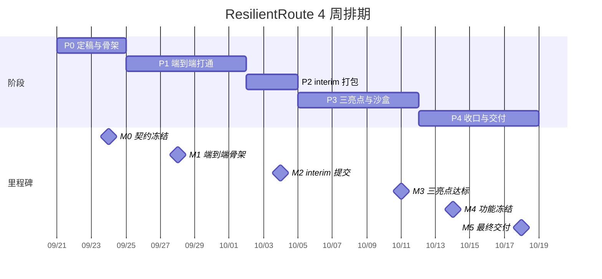

# 05 时间线与里程碑（2026-09-21 → 2026-10-18）

> 总时长 4 周（28 天），**10/04（周日）为 interim 提交**，**10/18（周日）为最终交付**。
> **工时账（务必按此执行）**：任务卡全部实现约 **360 人时**；4 周实际可支配约 **200–240 人时**。
> ⇒ **必须砍掉约三分之一**：砍单顺序与"绝不砍清单"见 `06` §3，「必做」集 ≈ **210 人时**。每个阶段的"交付物"清单即该阶段的「必做」范围，**清单外的都是可选**。

**注意**：9/26（周六）中秋節翌日、10/1（周四）国庆日为公众假期（港铁使用"周日及公众假期"班距）。团队按可工作安排，但**这两天任务量减半**，且这两天的产出直接用于"真实服务日历"演示素材。

---

## M0 — 9/21（周一）→ 9/24（周四）：定稿与骨架

**目标**：三个人都"能跑起来"，契约冻结，A 不等任何人就能开工。

| 天 | A | B | C |
|---|---|---|---|
| 9/21 一 | 30 分钟定稿会；建仓库；前端脚手架 + 底图降级链（T6.1） | 定稿会；事件数据模型 + SQLite（T2.1） | 定稿会；网络数据包 v0（T3.1） |
| 9/22 二 | 地图图层：六站 + 替代线 + 800 m 圈（T6.2）**🔁 今晚收 C 的 `network.seed.json`** | 天文台信号源（T2.2）+ 社媒模拟流（T2.4） | 交付 `network.seed.json`；坐标与接入点（T3.2）；LLM 客户端（T8.1） |
| 9/23 三 | 用种子数据渲染 3 张事件卡（前置 T6.5 简化版）**🔁 今晚收 B 的 `event.seed.json`** | 交付 `event.seed.json`；审核状态机骨架 | headway 时序图构建器（T3.3） |
| 9/24 四 | **集成夜 #1**：三方合分支，A 用 C 的图 + B 的事件卡出画面 | **契约冻结评审（T1.2，22:00）** | 契约冻结评审；图快照机制（T3.4） |

**M0 交付物**
- [ ] `contracts/` v1.0 冻结，四个种子文件齐全且通过 Schema 校验
- [ ] `main` 上：前端能开、后端能起、地图有六站与 800 m 圈、能显示 3 张事件卡
- [ ] 看板 77 张卡全部就位（T1.3，含「必做/应做/可选」标记）
- [ ] 出处台账 `data/PROVENANCE.md` 建立（T7.1）+ 巴士线路真实性核实（T7.2）

**M0 风险闸门**：若 9/24 晚契约没冻结 → 强制降级：删掉所有"可选字段"，只保留 `03` 中标记为必填的字段。

---

## M1 — 9/25（周五）→ 10/1（周四）：端到端打通（Happy Path）

**目标**：**一条链路从头走到尾**：注入事件 → 审核发布 → 区段关闭 → 重算路线 → 地图变色 + 卡片刷新。允许丑，不允许断。

| 天 | 重点 | 负责人 |
|---|---|---|
| 9/25–9/26 | B：AI 结构化 + 规则兜底 + 置信度引擎；C：候选生成 + 硬约束过滤；A：路线卡片 + 区段样式 | B / C / A |
| 9/27（日）| **首次 dry-run**：走一遍"事件 → 卡片"链路（此时路线可能是占位数据）；风险登记册首次更新 | 全员 |
| 9/28（一）| **M1 检查点**：`/api/routes/query` 能返回真实候选（≥ 8 条），地图能着色 | C + A |
| 9/29–9/30 | B：事件聚合去重 + 审核台后端 + SSE；C：打分与解释（T3.7）；A：审核台界面（T2.13）+ 时间线（T6.6） | 全员 |
| 10/1（四，假期，减半）| B：用户上报链路；C：性能与缓存；A：新鲜度徽标（T6.9） | 全员 |

**M1 交付物**
- [ ] 全链路可跑（含一次"用户上报 → 合并进事件 → 置信度上升"的演示）
- [ ] 路线卡片含 7 要素：打分拆解 / ETA 区间 / 风险 / 备注 / 来源 / 新鲜度 / 免责声明
- [ ] `07` 的 5 分钟脚本初稿（T10.2）

**M1 风险闸门**：若 9/28 路线引擎未出结果 → 立刻启用"种子路线 + 真事件"的组合演示（A 用 `routes.seed.json` 顶替），把 C 的时间全押在引擎上。

---

## M2 — 10/2（周五）→ 10/4（周日）：interim 冲刺与提交

**目标**：一个**能给别人看**的完整版本 + 英文材料，10/4 提交。

| 天 | 事项 | 负责人 |
|---|---|---|
| 10/2 | 修 M1 遗留问题；补种子数据；写英文 README + 架构图；部署上线（T9.2） | C 主 + A/B 补 |
| 10/3 | **22:00 冻结 interim 版本**；录 3 分钟演示视频（T10.3）；写进度报告；打包 | A 主 |
| 10/4 | **提交**（见下方清单）；提交后立刻开 P3 排期会 | A |

**10/4 interim 提交清单（逐项打勾）**
- [ ] 仓库链接 + 英文 README（含一键运行 + 架构图 + 数据来源说明）
- [ ] 可访问的线上地址（或"本地运行 + 视频"兜底说明）
- [ ] 3 分钟演示视频（MP4，含中英字幕）
- [ ] 进度报告（1–2 页英文）：已完成 / 进行中 / 下一步 / 阻塞点
- [ ] 架构图（PNG，从 `02` §1 导出）
- [ ] 数据与 AI 使用说明（来源、真实性分级、AI 边界）
- [ ] 看板快照 + 后两周计划（对应 `05` 的 P3/P4）
- [ ] 团队分工与个人贡献说明

**M2 通过标准**：外人在没有你讲解的情况下，看 README + 视频能明白"这是什么、怎么跑、亮点是什么"。

---

## P3 — 10/5（周一）→ 10/11（周日）：三个亮点达标 + 1 万人沙盒

**目标**：把 `07` §3 的三条验收指标**真正做达标**，而不是"做出来了"。

| 天 | 重点 | 负责人 |
|---|---|---|
| 10/5–10/6 | C：容量水桶 + 排队模型 + 公平约束（T5.1–T5.3）；B：画像库 + 预设权重 + 提示词纪律（T4.1–T4.3、T8.3）；A：分流看板骨架（T5.7） | 全员 |
| 10/7（三）| **集成夜 #3**：1 万人仿真首次跑通（哪怕慢） | C 主 |
| 10/8–10/9 | C：两种策略对比 + 结果落盘（真实数字替换占位）；A：画像对比视图（T4.4）+ AI 对话面板（T6.8）；B：自由文本解析 + 天气影响因子 | 全员 |
| 10/10 | 打磨：移动端、降级态、色盲友好、可达性；B：无 AI 兜底回归（T8.5） | 全员 |
| 10/11（日）| **M3 检查点**：三亮点逐条按 `07` §3 打勾 + dry-run + 决定砍单 | 全员 |

**M3 验收（不达标就必须砍或改叙事）**
- [ ] 早发现：文本 → 事件卡 ≤ 30 s；置信度 0.2→0.55→0.9 可复现；发布 → 地图变色 ≤ 5 s
- [ ] 懂个人：同一事件下"赶时间上班族"与"轮椅用户"首选路线不同，且解释可读
- [ ] 会分流：有/无引导对比图可见；过载线路数下降；**运力缺口数字如实显示**
- [ ] 数据真实性：抽查 10 条，全部能指出来源或明确标注"模拟"

---

## P4 — 10/12（周一）→ 10/18（周日）：收口与交付

| 天 | 事项 | 负责人 |
|---|---|---|
| 10/12–10/13 | 真实数据校准（班距/票价/服务日历）；bug bash：**打乱角色互测**；边缘场景（非高峰/雨天/多区段中断/轮椅用户） | 全员 |
| 10/14（三）| **功能冻结（Feature Freeze）**：此后只修 bug，不加功能 | 全员 |
| 10/15–10/16 | 部署终版 + 性能压测 + 离线兜底包 + 录最终视频 + 做 PPT | C / A |
| 10/17（六）| **最终彩排 ×2**（含一次故障演练：断网 / LLM 挂 / 后端挂）+ 材料终检（英文）+ 问答演练 | 全员 |
| 10/18（日）| **最终交付** | A 主 |

**M4/M5 交付物**
- [ ] 冻结版本的线上地址 + 本地一键运行
- [ ] 最终 PPT（英文）+ 演示视频（含字幕）+ README
- [ ] 三亮点验收记录（截图 + 数字证据）
- [ ] 数据出处台账终版 + AI 使用说明
- [ ] 离线兜底包（预生成数据 + 录屏 + 本地启动脚本）
- [ ] 问答库（≥ 15 条）

---

## 缓冲与应急预案

| 情形 | 动作 |
|---|---|
| 某人某周落后 > 1 天 | 立刻启动备份人接手该卡的"最小版本"，并在看板标 `Blocked` |
| C 的引擎延期 | A 用种子数据继续做前端；演示改用"预计算场景"（多条预演算好的路线） |
| B 的 AI 结构化不稳 | 全程切规则抽取 + 人工审核（**事件卡仍能演示，且展示"无 AI 也能跑"的稳健性**） |
| 部署不可用 | 切本地 + 录屏演示；提前把离线兜底包做完 |
| 10/11 三亮点不达标 | 按 `06` §3 砍单，演示脚本同步改（把不达标项从"亮点"降级为"已知局限"，如实说明） |
