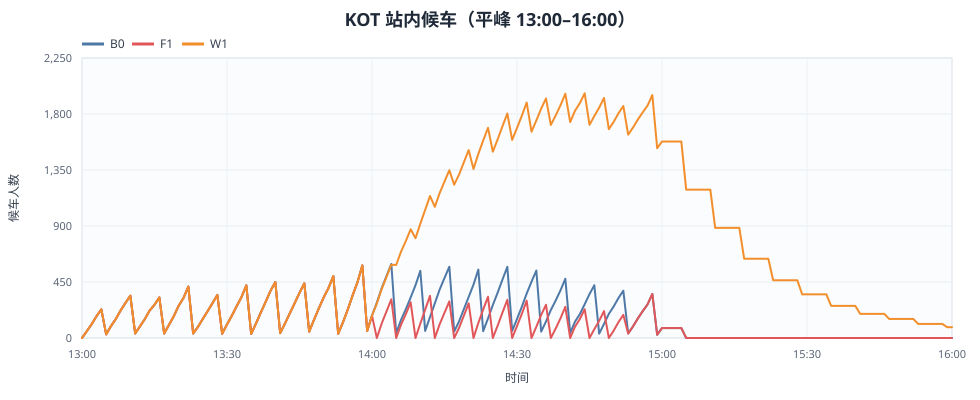
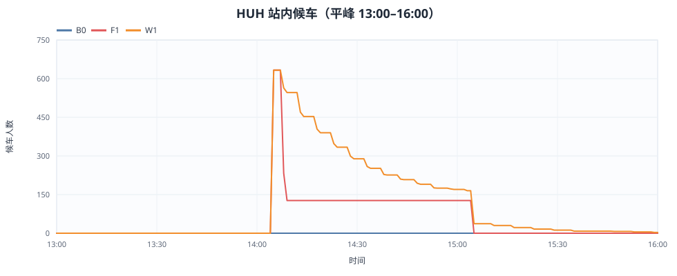
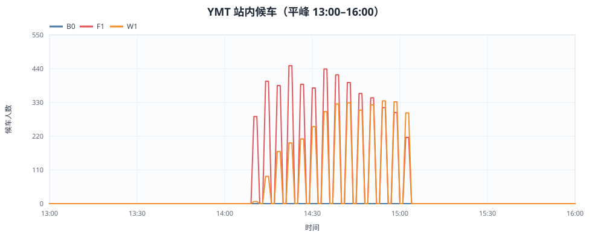
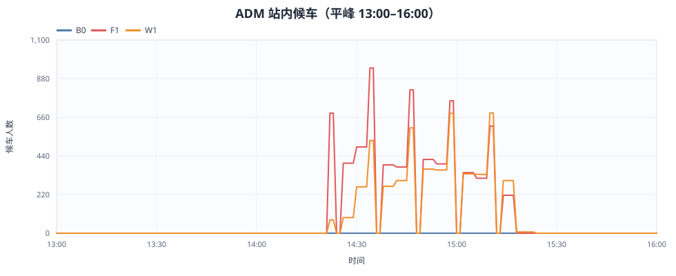
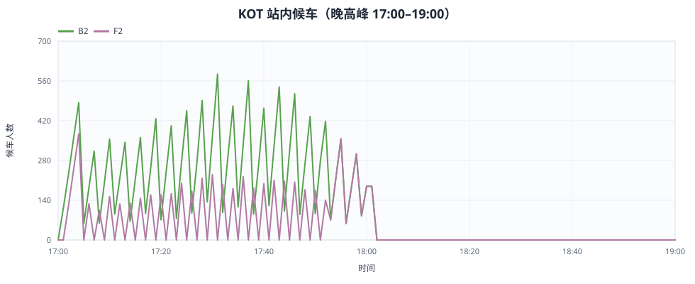
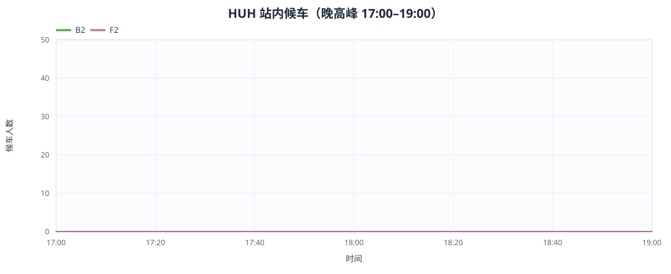
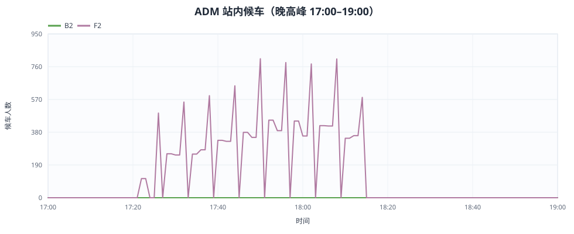
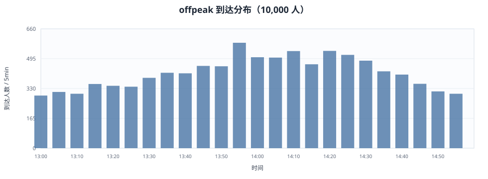
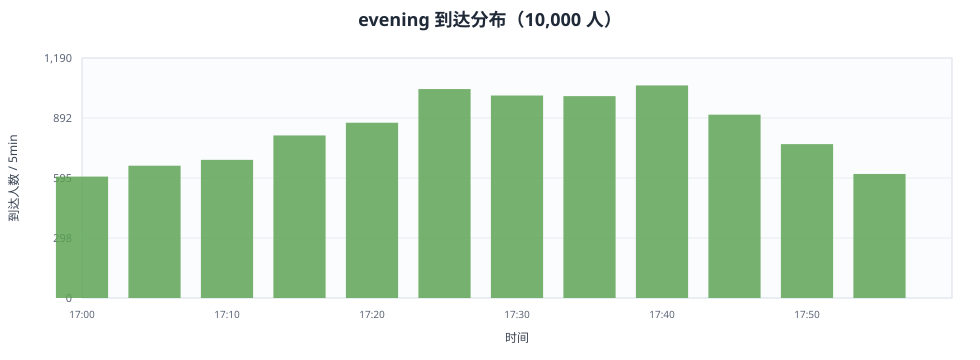

# 九龍塘 → 會展 10,000 人 C++ 沙盒模擬測試報告

**場景**：2026-10-15，平峰 13:00–15:00（10,000 人 / 2h）與晚高峰 17:00–18:00（同一批 10,000 人壓縮至 1h）；**容量**：每列車最多 95% 物理容量；**seed**：20260922；**population hash**：`9cc88d73b34c0acc`。

> 本報告是沙盒模擬，不是官方運輸預測。所有需求、到達曲線、故障窗口、等待分佈與容量假設均為情境假設；網絡/班距/容量沿用倉庫的 real-derived / unverified 數據。

## 1. 摘要

- **平峰 B0**：10,000 人全部送達，平均行程 **14.23 min**；KOT 峰值候車 **644 人**；無容量拒載。
- **平峰 F1（故障即時重規）**：5,701 人受影響（57.0%），平均到達延誤 **9.50 min**，P95 **17.00 min**；受影響者平均延誤 **16.67 min**；HUH 強制落車 **633** 人，HUH 峰值候車 **633 人**。
- **平峰 W1（原地等待）**：6,091 人受影響，平均到達延誤 **19.23 min**，P95 **60.00 min**；KOT 峰值候車 **2057 人**，其中政策等待峰值 **1743 人**；HUH 峰值候車 **633 人**（全部為政策等待）。
- **晚高峰 B2**：10,000 人全部送達，平均行程 **12.82 min**；KOT 峰值候車 **682 人**。
- **晚高峰 F2（故障即時重規）**：9,029 人受影響（90.3%），平均到達延誤 **12.57 min**，P95 **17.00 min**；受影響者平均延誤 **13.92 min**。
- **關鍵發現**：故障後五種畫像的首選替代是 **KTL + TWL + ERL**（2 次轉乘、0 步行），但故障前已上車的乘客會在 HUH 被截停：F1 有 **633** 人、W1 有 **633** 人被強制落車。其中輪椅乘客 F1 **127** 人、W1 **127** 人在 HUH 沒有可用的無障礙替代，只能等到 15:00 恢復（F1 該群平均延誤 **60.00 min**）。95% 容量上限全程未被觸發，最大單車負載率僅 **0.348**（ERL (reverse) / F1）；主要風險是繞行延誤、HUH 強制落車與無障礙缺口，不是列車容量。

## 2. 場景與假設

### 2.1 時段與組別

| 組 | 時段 | 到達窗口 | 故障 | 策略 | 服務人數 | 平均行程 (min) | 平均延誤 (min) |
|---|---|---|---|---|---|---|---|
| B0 | 平峰 | 13:00–15:00 | — | 正常 | 10000 | 14.23 | 0.00 |
| F1 | 平峰 | 13:00–15:00 | 14:00–15:00 | 即時重規 | 10000 | 23.73 | 9.50 |
| W1 | 平峰 | 13:00–15:00 | 14:00–15:00 | 原地等待 20 min | 10000 | 33.46 | 19.23 |
| B2 | 晚高峰 | 17:00–18:00 | — | 正常 | 10000 | 12.82 | 0.00 |
| F2 | 晚高峰 | 17:00–18:00 | 17:00–18:00 | 即時重規 | 10000 | 25.39 | 12.57 |

平峰到達曲線為分段線性非齊次泊松強度（13:00 0.7、13:30 0.9、14:00 1.3、14:30 1.2、15:00 0.7，歸一化到 10,000），以拒絕採樣產生恰好 10,000 個到達時刻；晚高峰把同一批乘客的平峰到達時刻按窗口比例壓縮到 17:00–18:00，乘客身份、畫像、順序與等待樣本完全不變，因此平均到達率由 **5,000 人/h** 提升到 **10,000 人/h**。

### 2.2 五種畫像與權重

| 畫像 | mobility | 人數 | time | transfers | walk | price | reliability | max walk (m) | speed (m/s) | max transfers |
|---|---|---|---|---|---|---|---|---|---|---|
| commuter | standard | 2000 | 0.50 | 0.10 | 0.10 | 0.10 | 0.20 | 800 | 1.4 | 3 |
| elderly | reduced | 2000 | 0.25 | 0.15 | 0.25 | 0.05 | 0.30 | 400 | 0.7 | 3 |
| student | standard | 2000 | 0.25 | 0.10 | 0.10 | 0.45 | 0.10 | 800 | 1.4 | 3 |
| tourist | standard | 2000 | 0.20 | 0.35 | 0.15 | 0.10 | 0.20 | 800 | 1.4 | 3 |
| wheelchair | wheelchair | 2000 | 0.20 | 0.10 | 0.30 | 0.05 | 0.35 | 400 | 0.7 | 2 |

權重直接取自倉庫 `backend/app/engine/fairness.py` 的 `PERSONA_WEIGHTS`；C++ 導出時讀取，不在程式內硬編碼。

### 2.3 故障與容量

- 故障：ERL 紅磡–會展段（HUH↔EXC）雙向封閉 1 小時；平峰 14:00–15:00、晚高峰 17:00–18:00。ADM–EXC 段仍開行；故障期間 ERL 以短交路維持可服務區段。
- 容量：每列車最多 `floor(0.95 × vehicle_capacity)`；ERL 2,702、TML/KTL/TWL/ISL 2,375、BUS_182 130、BUS_81C 130。95% 是**上車上限**，不是背景乘客已佔用 95% 的假設；本模擬沒有背景乘客。
- 票價：MTR 以 KOT→EXC 的 13.2 HKD OD 票價作 group fare 近似；巴士用 section fare；僅用於 price 權重。

## 3. 方法

1. **路線目錄**：由現有 Python `RouteEngine.query_details` 在 normal/closure 兩種網絡狀態、三種 mobility、15 個 MTR 決策站、平峰/晚高峰參考時刻生成；C++ 只做時序評價、畫像排序與事件模擬，不重寫圖搜索。
2. **路線評價**：步行用個人速度；軌道/巴士按 line stops 與 offpeak/peak 班距計算下一班車，逐段檢查故障封閉；可靠度以模式 CV 與行程時間計算。
3. **畫像排序**：完全復刻 `fairness.rank_routes` 的 time/transfers/walk/price/reliability 歸一化與加權；取最高排名可行路線。
4. **事件模擬**：列車逐站事件、月台 FIFO 排隊、95% 單車容量、短交路、強制落車、原地等待、重規與重試；每 60 s 記錄關鍵站候車，峰值與人·分鐘按事件精確積分。
5. **延誤**：同一個 passenger_id 與同時段基準組（平峰 B0、晚高峰 B2）配對，`actual_arrival_EXC − baseline_arrival_EXC`。

## 4. 平峰結果（B0 / F1 / W1）

| 組 | 時段 | 故障 | 策略 | 送達 | 平均行程 | 平均延誤 | P50 | P90 | P95 | 最大 | >15min | 平均候車 | 平均政策等待 | 受影響 |
|---|---|---|---|---|---|---|---|---|---|---|---|---|---|---|
| B0 | 平峰 | 无故障 | 即时 | 10000 | 14.23 | 0.00 | 0.00 | 0.00 | 0.00 | 0.00 | 0.0% | 2.98 | 0.00 | 0 |
| F1 | 平峰 | 故障 | 即时 | 10000 | 23.73 | 9.50 | 11.00 | 17.00 | 17.00 | 60.00 | 42.7% | 6.54 | 0.00 | 5701 |
| W1 | 平峰 | 故障 | 原地等待 | 10000 | 33.46 | 19.23 | 17.00 | 47.00 | 60.00 | 150.00 | 56.2% | 17.99 | 12.37 | 6091 |

### 4.1 畫像差異

| 組 | 畫像 | 人數 | 送達 | 平均行程 | 平均候車 | 平均轉乘 | 平均延誤 | P95 延誤 |
|---|---|---|---|---|---|---|---|---|
| B0 | commuter | 2000 | 2000 | 14.22 | 2.97 | 0.00 | 0.00 | 0.00 |
| B0 | elderly | 2000 | 2000 | 14.22 | 2.97 | 0.00 | 0.00 | 0.00 |
| B0 | student | 2000 | 2000 | 14.20 | 2.95 | 0.00 | 0.00 | 0.00 |
| B0 | tourist | 2000 | 2000 | 14.24 | 2.99 | 0.00 | 0.00 | 0.00 |
| B0 | wheelchair | 2000 | 2000 | 14.25 | 3.00 | 0.00 | 0.00 | 0.00 |
| F1 | commuter | 2000 | 2000 | 23.17 | 5.78 | 1.15 | 8.94 | 17.00 |
| F1 | elderly | 2000 | 2000 | 23.71 | 6.23 | 1.20 | 9.50 | 29.00 |
| F1 | student | 2000 | 2000 | 22.80 | 5.67 | 1.11 | 8.60 | 17.00 |
| F1 | tourist | 2000 | 2000 | 23.44 | 5.87 | 1.19 | 9.20 | 17.00 |
| F1 | wheelchair | 2000 | 2000 | 25.53 | 9.14 | 0.98 | 11.28 | 60.00 |
| W1 | commuter | 2000 | 2000 | 33.95 | 18.38 | 0.81 | 19.72 | 59.05 |
| W1 | elderly | 2000 | 2000 | 33.43 | 17.77 | 0.85 | 19.21 | 54.00 |
| W1 | student | 2000 | 2000 | 31.94 | 16.37 | 0.81 | 17.74 | 53.00 |
| W1 | tourist | 2000 | 2000 | 33.49 | 17.74 | 0.84 | 19.25 | 54.00 |
| W1 | wheelchair | 2000 | 2000 | 34.49 | 19.71 | 0.67 | 20.24 | 60.00 |

### 4.2 路線分擔

| 組 | 路線（初始） | 人數 | 分擔 | 平均行程 | 平均延誤 |
|---|---|---|---|---|---|
| B0 | ERL | 10000 | 100.0% | 14.23 | 0.00 |
| F1 | ERL | 5112 | 51.1% | 18.07 | 3.81 |
| F1 | KTL + TWL + ERL | 4888 | 48.9% | 29.65 | 15.46 |
| W1 | ERL | 6696 | 67.0% | 29.53 | 15.29 |
| W1 | KTL + TWL + ERL | 3304 | 33.0% | 41.42 | 27.22 |

故障前按當時正常網絡上車的乘客，會在 14:00 後於 HUH 被截停：F1 共 **633** 名（輪椅 127、長者 106、標準 400）。輪椅在 HUH 的無障礙候選為 0，只能等到 15:00 恢復，平均延誤 **60.00 min**；長者改走 TML+KTL，平均 **29.00 min**；標準改走 TML+步行+TWL，平均 **17.00 min**。故障後才在 KOT 決定的乘客首選 **KTL + TWL**（**4,888** 名）；初始 ERL 路線 **5,112** 名，其中未受影響 **4,299** 名、HUH 被截停 **633** 名、14:00 掃描時仍在 KOT 等待而被重規 **180** 名；兩者合計 **5,701** 名受影響（= 4,888 + 633 + 180）。經 HUH 的 ERL+TML+步行替代路線因此由被截停的標準乘客使用，TST 峰值候車 **400 人**。F1 共 **813** 次中途重規（633 次由 HUH 強制落車觸發，其餘為 14:00 掃描時仍在站等待的乘客）。W1 的 633 名被截停者全部在 HUH 進入政策等待，HUH 峰值 **633 人**；KOT 峰值 **2057 人**（政策等待峰值 **1743 人**）。

### 4.3 關鍵站滯留

「峰值總候車」包含正常班距等待；「峰值非正常」只含容量拒載、故障/強制落車/無路線與 W1 政策等待。人·分鐘由事件積分，不是快照相加。

**B0**

| 車站 | 峰值總候車 | 峰值時刻 | 峰值非正常 | 非正常時刻 | 人·分（總） | 人·分（非正常） |
|---|---|---|---|---|---|---|
| KOT | 644 | 14:04:30 | 0 | — | 29759.8 | 0.0 |
| MKK | 0 | — | 0 | — | 0.0 | 0.0 |
| HUH | 0 | — | 0 | — | 0.0 | 0.0 |
| ETS | 0 | — | 0 | — | 0.0 | 0.0 |
| TST | 0 | — | 0 | — | 0.0 | 0.0 |
| YMT | 0 | — | 0 | — | 0.0 | 0.0 |
| ADM | 0 | — | 0 | — | 0.0 | 0.0 |
| EXC | 0 | — | 0 | — | 0.0 | 0.0 |

**F1**

| 車站 | 峰值總候車 | 峰值時刻 | 峰值非正常 | 非正常時刻 | 人·分（總） | 人·分（非正常） |
|---|---|---|---|---|---|---|
| KOT | 633 | 13:58:29 | 1 | 14:00:00 | 24401.8 | 0.0 |
| MKK | 0 | — | 0 | — | 0.0 | 0.0 |
| HUH | 633 | 14:04:45 | 128 | 14:04:45 | 9370.5 | 7018.9 |
| ETS | 0 | — | 0 | — | 0.0 | 0.0 |
| TST | 400 | 14:17:00 | 0 | — | 0.0 | 0.0 |
| YMT | 491 | 14:19:30 | 0 | — | 10189.0 | 0.0 |
| ADM | 941 | 14:34:00 | 0 | — | 20990.0 | 0.0 |
| EXC | 0 | — | 0 | — | 0.0 | 0.0 |

**W1**

| 車站 | 峰值總候車 | 峰值時刻 | 峰值非正常 | 非正常時刻 | 人·分（總） | 人·分（非正常） |
|---|---|---|---|---|---|---|
| KOT | 2057 | 14:40:59 | 1743 | 14:40:49 | 136929.8 | 110603.7 |
| MKK | 0 | — | 0 | — | 0.0 | 0.0 |
| HUH | 633 | 14:04:45 | 633 | 14:04:45 | 19520.0 | 17692.0 |
| ETS | 0 | — | 0 | — | 0.0 | 0.0 |
| TST | 76 | 14:22:00 | 0 | — | 575.0 | 0.0 |
| YMT | 336 | 14:43:30 | 0 | — | 6985.5 | 0.0 |
| ADM | 685 | 15:10:00 | 0 | — | 15658.0 | 0.0 |
| EXC | 0 | — | 0 | — | 0.0 | 0.0 |

F1 的壓力點是 **HUH（峰值 633，非正常 128）**、**TST（400）**、YMT 與 ADM；W1 的 KOT（2057）與 HUH（633）承受政策等待。ETS、MKK、EXC 在三組均為 0：並非故障沒有影響，而是 KTL+TWL 走廊分走了大部分需求，只有被截停者才在 HUH 轉乘，ETS 只作為 TML 的通過站。KOT 是上車排隊、HUH 是強制落車/等待、YMT 是 KTL→TWL 換乘、TST 是步行→TWL、ADM 是 TWL→ERL 換乘，這些站才是本次故障的實際壓力點。

註：F1 的 TST 峰值 400 人與 KOT 非正常峰值 1 人屬於瞬時換乘排隊（列車同步到站），因此對應的人·分接近 0；峰值人數仍按事件記錄。









## 5. 晚高峰結果（B2 / F2）

| 組 | 時段 | 故障 | 策略 | 送達 | 平均行程 | 平均延誤 | P50 | P90 | P95 | 最大 | >15min | 平均候車 | 平均政策等待 | 受影響 |
|---|---|---|---|---|---|---|---|---|---|---|---|---|---|---|
| B2 | 晚高峰 | 无故障 | 即时 | 10000 | 12.82 | 0.00 | 0.00 | 0.00 | 0.00 | 0.00 | 0.0% | 1.57 | 0.00 | 0 |
| F2 | 晚高峰 | 故障 | 即时 | 10000 | 25.39 | 12.57 | 14.00 | 14.00 | 17.00 | 17.00 | 6.5% | 4.66 | 0.00 | 9029 |

### 5.1 畫像差異

| 組 | 畫像 | 人數 | 送達 | 平均行程 | 平均候車 | 平均轉乘 | 平均延誤 | P95 延誤 |
|---|---|---|---|---|---|---|---|---|
| B2 | commuter | 2000 | 2000 | 12.83 | 1.58 | 0.00 | 0.00 | 0.00 |
| B2 | elderly | 2000 | 2000 | 12.80 | 1.55 | 0.00 | 0.00 | 0.00 |
| B2 | student | 2000 | 2000 | 12.80 | 1.55 | 0.00 | 0.00 | 0.00 |
| B2 | tourist | 2000 | 2000 | 12.83 | 1.58 | 0.00 | 0.00 | 0.00 |
| B2 | wheelchair | 2000 | 2000 | 12.82 | 1.57 | 0.00 | 0.00 | 0.00 |
| F2 | commuter | 2000 | 2000 | 25.49 | 4.69 | 1.82 | 12.66 | 17.00 |
| F2 | elderly | 2000 | 2000 | 25.40 | 4.65 | 1.81 | 12.60 | 17.00 |
| F2 | student | 2000 | 2000 | 25.31 | 4.62 | 1.80 | 12.51 | 17.00 |
| F2 | tourist | 2000 | 2000 | 25.37 | 4.65 | 1.80 | 12.54 | 17.00 |
| F2 | wheelchair | 2000 | 2000 | 25.36 | 4.67 | 1.80 | 12.53 | 17.00 |

### 5.2 路線分擔

| 組 | 路線（初始） | 人數 | 分擔 | 平均行程 | 平均延誤 |
|---|---|---|---|---|---|
| B2 | ERL | 10000 | 100.0% | 12.82 | 0.00 |
| F2 | KTL + TWL + ERL | 9029 | 90.3% | 26.73 | 13.92 |
| F2 | ERL | 971 | 9.7% | 12.92 | 0.00 |

晚高峰 F2 的 **9,029** 名乘客（90.3%）改走 KTL+TWL；**971** 名（9.7%）在 17:52:30 之後到達，下一班 ERL 已在 18:00 恢復後，直接搭 ERL，延誤為 0。由於晚高峰班距更密（ERL 3 min、KTL/TWL 2 min），受影響者的平均延誤（13.92 min）反而略低於平峰（16.67 min），但受影響比例由 57.0% 升到 90.3%，整體平均延誤由 9.50 min 升到 12.57 min。

### 5.3 關鍵站滯留

**B2**

| 車站 | 峰值總候車 | 峰值時刻 | 峰值非正常 | 非正常時刻 | 人·分（總） | 人·分（非正常） |
|---|---|---|---|---|---|---|
| KOT | 682 | 17:31:30 | 0 | — | 15674.9 | 0.0 |
| MKK | 0 | — | 0 | — | 0.0 | 0.0 |
| HUH | 0 | — | 0 | — | 0.0 | 0.0 |
| ETS | 0 | — | 0 | — | 0.0 | 0.0 |
| TST | 0 | — | 0 | — | 0.0 | 0.0 |
| YMT | 0 | — | 0 | — | 0.0 | 0.0 |
| ADM | 0 | — | 0 | — | 0.0 | 0.0 |
| EXC | 0 | — | 0 | — | 0.0 | 0.0 |

**F2**

| 車站 | 峰值總候車 | 峰值時刻 | 峰值非正常 | 非正常時刻 | 人·分（總） | 人·分（非正常） |
|---|---|---|---|---|---|---|
| KOT | 491 | 17:04:59 | 0 | — | 11028.4 | 0.0 |
| MKK | 0 | — | 0 | — | 0.0 | 0.0 |
| HUH | 0 | — | 0 | — | 0.0 | 0.0 |
| ETS | 0 | — | 0 | — | 0.0 | 0.0 |
| TST | 0 | — | 0 | — | 0.0 | 0.0 |
| YMT | 491 | 17:14:00 | 0 | — | 18058.0 | 0.0 |
| ADM | 806 | 17:50:00 | 0 | — | 17470.0 | 0.0 |
| EXC | 0 | — | 0 | — | 0.0 | 0.0 |







## 6. 跨時段對比

- 到達率：平峰 **5000 人/h**，晚高峰 **10000 人/h**（2×）。
- B0 → B2：平均行程由 **14.23** 降至 **12.82 min**，主要因為晚高峰班距更密；KOT 峰值候車由 **644** 變為 **682**。
- F1 → F2：受影響比例由 **57.0%** 升至 **90.3%**，整體平均延誤由 **9.50** 升至 **12.57 min**；但受影響者的平均延誤由 **16.67** 降至 **13.92 min**，說明晚高峰的風險是「更多人被捲入」，不是「每人延誤更長」。

### 6.1 到達分布





### 6.2 到達延誤 CDF


## 7. 容量與線路負載

| 組 | 線路 | 方向 | 列車數 | 95% 單車容量 | 上車人數 | 最大在車 | 最大負載率 | 拒載 |
|---|---|---|---|---|---|---|---|---|
| B0 | ERL | 上行 | 94 | 2702 | 10000 | 644 | 0.238 | 0 |
| F1 | ERL | 上行 | 104 | 2702 | 5059 | 633 | 0.234 | 0 |
| F1 | ERL | 下行 | 104 | 2702 | 5574 | 941 | 0.348 | 0 |
| F1 | KTL | 上行 | 142 | 2375 | 5068 | 450 | 0.190 | 0 |
| F1 | KTL | 下行 | 142 | 2375 | 106 | 106 | 0.045 | 0 |
| F1 | TML | 上行 | 105 | 2375 | 400 | 400 | 0.168 | 0 |
| F1 | TML | 下行 | 105 | 2375 | 106 | 106 | 0.045 | 0 |
| F1 | TWL | 上行 | 142 | 2375 | 5574 | 684 | 0.288 | 0 |
| W1 | ERL | 上行 | 104 | 2702 | 6695 | 633 | 0.234 | 0 |
| W1 | ERL | 下行 | 104 | 2702 | 3938 | 685 | 0.254 | 0 |
| W1 | KTL | 上行 | 142 | 2375 | 3470 | 335 | 0.141 | 0 |
| W1 | KTL | 下行 | 142 | 2375 | 91 | 18 | 0.008 | 0 |
| W1 | TML | 上行 | 105 | 2375 | 377 | 76 | 0.032 | 0 |
| W1 | TML | 下行 | 105 | 2375 | 91 | 18 | 0.008 | 0 |
| W1 | TWL | 上行 | 142 | 2375 | 3938 | 365 | 0.154 | 0 |
| B2 | ERL | 上行 | 54 | 2702 | 10000 | 682 | 0.252 | 0 |
| F2 | ERL | 上行 | 74 | 2702 | 971 | 425 | 0.157 | 0 |
| F2 | ERL | 下行 | 74 | 2702 | 9029 | 806 | 0.298 | 0 |
| F2 | KTL | 上行 | 82 | 2375 | 9029 | 491 | 0.207 | 0 |
| F2 | TWL | 上行 | 82 | 2375 | 9029 | 491 | 0.207 | 0 |

全程最大單車負載率僅 **0.348**（ERL (reverse) / F1），沒有容量拒載。95% 容量上限在本場景不是瓶頸；把 10,000 人集中在 KTL+TWL 仍只用到約 15–35% 的單車容量。因此本次測試的風險是**延誤、站點聚集與走廊集中**，不是「列車裝不下」。

## 8. 公平性與無障礙

在未被 HUH 截停的乘客中，五種畫像的延誤接近（見 4.1/5.1）；原因是五種畫像都選擇同一條 KTL+TWL 替代路線，權重差異沒有改變首選。這本身是一個集中風險：一旦 KTL/TWL 也受影響，系統沒有第二條被使用的走廊。

無障礙方面，倉庫對輪椅使用者的保守政策（`no_non_lowfloor_bus`）令 closure / wheelchair / HUH 的候選目錄為 **0 條**；這不是抽象缺口：平峰 F1/W1 各有 **127** 名輪椅乘客在 HUH 被截停，系統在 HUH 找不到可用的無障礙替代，只能等到 15:00 恢復。F1 該群平均延誤 **60.00 min**，W1 該群平均 **60.76 min**；W1 全體強制落車者的最大延誤為 150.00 min（含指數等待長尾）。晚高峰 F2 的故障從 17:00 開始，沒有故障前已上車的乘客，因此沒有觸發 HUH 截停；但缺口在平峰已經被證實存在。

## 9. 限制與不確定性

- **95% 的含義**：每車最多 95% 物理容量；不是「95% 已被背景乘客佔用、只剩 5%」。後者會造成大量拒載，需另設背景負載場景。
- 沒有背景乘客、其他 OD、車站入口/閘機/月台站立面積/人群安全模型；「候車/滯留」是排隊抽象。
- 沒有列車停站時間、跳站、車廂站立密度、輪椅專用空間、電梯故障、天氣；列車按引擎 segment 時間運行。
- 路線選擇是靜態最高排名，不根據現場排隊動態分流。故障發生前乘客按當時正常網絡規劃；14:00（平峰）/17:00（晚高峰）後系統即時知道故障，平峰 F1/W1 因此有 HUH 強制落車與重規/等待；晚高峰 F2 的故障從窗口開始，沒有故障前上車者。
- 只模擬 KOT→EXC；中途重規限於目錄中的 MTR 決策站；巴士站/碼頭作為路線節點。
- 無障礙輸入把 seed 的 null 站點 accessibility 正規化為 `data/network/stations.json` 的 true；`reduced` 仍排除低地板未確認的巴士；輪椅 max_transfers=2、max_walk=400。
- 路線候選沿用引擎 `select_diverse`；標準乘客在故障下不會看到純 KTL/TWL 以外的所有路徑，而本次 KTL+TWL 恰好是畫像權重下的首選，這是系統行為發現，不是 C++ 額外限制。
- 票價是近似值，只用於 price 權重；不是票務精算。
- W1「泊松等待」按泊松過程的等待時間 Exponential(mean=20 min) 實作；20 min 是均值而非上限，因此存在長尾（本次 W1 最大延誤 150.00 min）。
- 故障時點按「高峰中發生」解讀：平峰 14:00–15:00、晚高峰 17:00–18:00；可用 config 改。

## 10. 結論與建議

1. **即時重規（F1/F2）優於原地等待（W1）**：平峰 F1 平均延誤 **9.50 min**，W1 **19.23 min**；W1 的 20 min 均值等待普遍長於「直接改走 KTL+TWL」的 15.5 min 繞行，且 KOT 峰值候車被推到 **2057 人**（1743 人為政策等待）。
2. **晚高峰的風險是覆蓋面**：F2 **90.3%** 乘客受影響，受影響者平均延誤 **13.92 min**，與平峰 **16.67 min** 相近；晚高峰更密的班距縮短了單人等待，但 2× 到達率令更多人被捲入。
3. **HUH 不是 0，而是被截停點**：F1 在 HUH 峰值 **633 人**、強制落車 **633** 人；W1 在 HUH 峰值 **633 人**、全部為政策等待。其中 **127** 名輪椅乘客在 HUH 沒有無障礙替代，平均延誤 **60.00 min**。這是本次測試最重要的公平性缺口。
4. **容量不是本次瓶頸**：95% 上限下最大單車負載率僅 **0.348**，無拒載；真正需要管理的是月台候車、HUH 強制落車後的引導、換乘排隊、繞行時間與輪椅無障礙缺口。
5. **建議**：故障時把部分標準乘客引導到 HUH/ETS 走廊以分散 KTL/TWL，但必須同時為 HUH 的輪椅乘客準備可用的無障礙接駁或明確的等待恢復安排；在 KOT/HUH/YMT/ADM 提供實時排隊與替代路線資訊；把「等待恢復」與「立即繞行」的預期時間清楚告知乘客，而不是預設 20 min 被動等待。

## 11. 復現

```powershell
$env:PYTHONPATH = '.;backend'
.\.venv\Scripts\python.exe scripts\export_cpp_sim_inputs.py --check
powershell -ExecutionPolicy Bypass -File sim_cpp\build.ps1
sim_cpp\out\build\sim.exe --self-test --config sim_cpp\config\scenario.json --input sim_cpp\data\sim_input.json --out sim_cpp\out\selftest
sim_cpp\out\build\sim.exe --config sim_cpp\config\scenario.json --input sim_cpp\data\sim_input.json --out sim_cpp\out\run1
.\.venv\Scripts\python.exe scripts\verify_cpp_sim.py --out sim_cpp\out\run1
.\.venv\Scripts\python.exe scripts\render_cpp_sim_report.py --run sim_cpp\out\run1
```

**輸入 hash**：`97bd81139bf358cf`；**config hash**：`876d85a111146b6d`；**population hash**：`9cc88d73b34c0acc`。重跑 `run1`/`run2` 的 comparison.json 與 CSV hash 應完全一致。

### 數據文件

- `sim_cpp/out/run1/comparison.json`：五組指標、站點、畫像、路線、線路、跨時段。
- `sim_cpp/out/run1/B0|F1|W1|B2|F2/passengers.csv`：逐乘客記錄（到達、路線、等待、延誤、服務狀態）。
- `sim_cpp/out/run1/B0|F1|W1|B2|F2/station_waiting.csv`：60 s 逐站候車分類。
- `sim_cpp/out/run1/B0|F1|W1|B2|F2/line_loads.csv`：線路/方向負載。
- `sim_cpp/out/run1/arrivals.csv`：兩個時段的 5 min 到達分布。

## 附錄：指標定義

- **平均到達延誤**：`actual_arrival_EXC − baseline_arrival_EXC`（同 passenger_id；平峰基準 B0、晚高峰基準 B2）。
- **平均行程**：`actual_arrival_EXC − 該時段到達 KOT 的時刻`。
- **峰值總候車**：站內等待上車/重規/政策等待的瞬時人數峰值（含正常班距等待）。
- **峰值非正常**：容量拒載 + 故障/強制落車/無路線 + W1 政策等待的瞬時人數峰值。
- **人·分鐘**：候車人數對時間的積分；按事件精確累加。
- **受影響**：延誤 > 1 min 的乘客；`avg_delay_affected` 只在這些乘客上平均。
