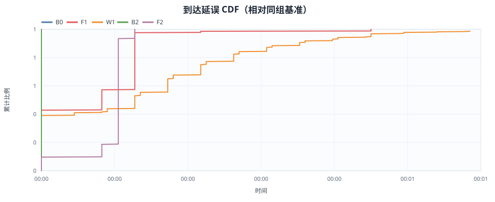
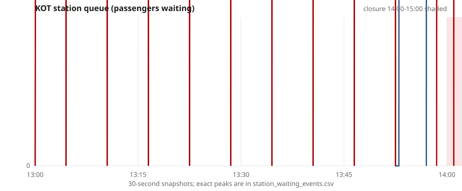
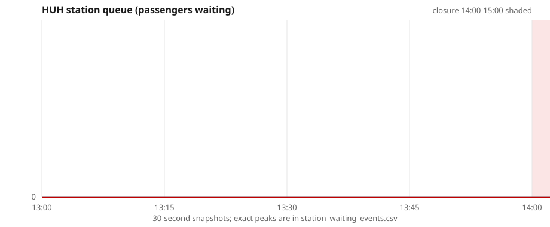
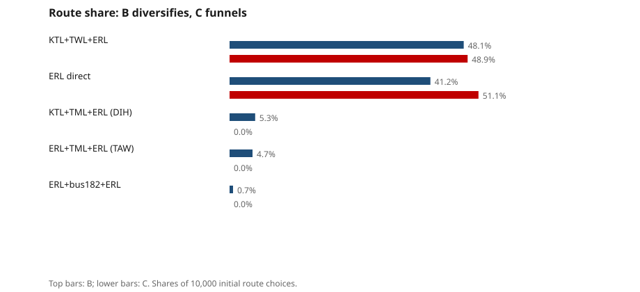
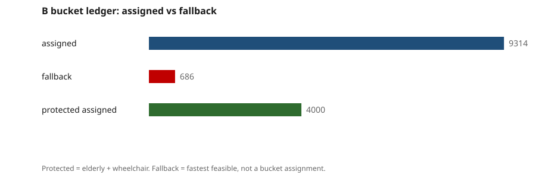

# 东铁 KOT→EXC 10,000 人沙盒仿真报告

> 运行目录：`sim_cpp/out/run1` · 输入 SHA256：`c6aaef9cb197173b…` · 验证：`sim_cpp/report/VERIFICATION.md`（PASS）

## 0. 结论摘要

1. **三组都 served 10,000 / censored 0，denied 全部为 0。** 在 95% 物理上限下，峰值列车载客率只有 A 23.8%、B 36.2%、C 34.8%，离 95% 很远；本场景的物理运力不是约束，3,400/460 的 bucket 规划 cap 才是约束。
2. **B（bucket）对 C（即时最快）不是全面胜利，而是分布性交换。** B 的平均到达延误 9.37 min，C 为 9.50 min（B 仅低 0.13 min）；B 最大延误 30 min，C 为 60 min；B forced alight 0，C 为 633。但 B 的 P95 为 18 min，C 为 17 min，B 反而差 1 min。
3. **B 的收益集中在 protected 群体，代价由普通群体承担。** 轮椅 P95 从 C 的 60 min 降到 B 的 17 min，长者从 29 降到 17；但通勤/学生/游客的平均延误分别从 8.94/8.60/9.20 升到 9.93/9.45/10.12 min。总体平均只低 0.13 min，是长者/轮椅的收益抵消了普通群体的损失。
4. **B 的主要机制是“已知计划性封闭 + protected-first 预分流”，不是 bucket 容量本身把需求均匀摊开。** 封闭期间 KOT→EXC 只有一条快速轨道绕行（KTL+TWL+ERL），bucket 无法把 14:00 后的需求分散到第二条同等级路线；686 人 fallback 仍回到同一条最快路线。
5. **bucket 规划 cap 确实绑定，并产生了可观察的副作用。** 1929 人至少撞到一次路线 bucket 上限，231 人撞到共享路段上限；9314 人被 bucket 分配，686 人 fallback；其中 71 人被分到 BUS_182（+13 min，仍在 15 min 公平上限内），把 B 的峰值车辆载客率推到 54.6%（BUS_182，71/130），而 C 的峰值为 34.8%。

## 1. 场景、方法与三组策略

### 1.1 需求

10,000 人，五类画像各 2,000：通勤、学生、游客、长者、轮椅；同一 `seed=20260922`。KOT（九龙塘）为唯一起点，EXC（会展）为终点。到达过程为 13:00–15:00 的非齐次泊松过程，强度剖面为 0.7→0.9→1.3→1.2→0.7（相对值），采用 thinning 采样后排序；三组共用同一批乘客 id、到达时刻和画像标签，因此 B/C 的到达延误可以按 passenger id 与 A 精确配对。
实际到达范围为 13:00:00–14:59:58；五类画像各 2,000 的计数在 self-test 中逐类校验。

### 1.2 供给、故障与列车行为

网络、线路、站序、区间运行时分、headway、车辆容量、票价和可靠性来自仓库的 `contracts/seed/network.seed.json`、`data/network/*.json` 与 `RouteEngine`；`scripts/export_cpp_sim_inputs.py` 导出 90 个 catalogue、501 条 route record、8 个 validation case，并写入 `sim_cpp/data/sim_input.json` 与 SHA256 sidecar。C++ 在乘客决策时刻重新评估 timetable，不重新实现图搜索。
故障为 ERL 的 HUH–EXC 段 14:00–15:00 关闭 1 h。封闭段无穿越服务；ERL 列车到边界终止；HUH 方向（TAW→ADM）的列车在 HUH 终止并强制 through passengers 下车；反向（ADM→TAW）列车在 EXC 终止；EXC–ADM 之间开行短交路（far-side shuttle）；15:00 起恢复全线。每车容量上限为 `floor(0.95 × capacity_per_vehicle)`：ERL 2,702、KTL/TWL 2,375、BUS_182 130。站台按 (station, line, direction) FIFO 排队；先下后上；满车拒载；不允许静默超载（C++ 在 onboard > capacity 时直接抛错）。无背景客流，无 dwell/bunching，无电梯故障，无天气影响。

### 1.3 三组策略

| 组 | 网络状态 | 决策信息 | 路线选择 |
|---|---|---|---|
| A | 无故障 | 正常时刻表 | persona 权重排序后的最优可行路线（全部 ERL 直达） |
| B | 故障 | **已知 14:00–15:00 的计划性封闭窗口**，评估整段行程 | protected-first bucket：路线 + 共享有向路段容量；最多比个人最快多 15 min；不足则 fallback |
| C | 故障 | 只看到发车时刻已经生效的封闭，不预知未来 | 不考虑 persona 权重的最快可行路线；被强制下车后再即时重规划 |

**信息假设必须明说：B 的规划器拥有计划性封闭窗口的先验知识，C 没有。** 这是 B 能提前把 13:52–14:00 到达的乘客从 ERL 直达改到 KTL 绕行的根本原因。若把同样的先验信息给 C，B 的 forced alight 和最大延误优势会大幅缩小；因此下文的 B vs C 不是“同一信息集下的算法对比”，而是“计划型 bucket vs 即时型最快”的策略对比。

### 1.4 事件仿真与指标

C++20 事件循环按时刻推进：乘客到达 KOT、步行、站台排队、列车到站/上下客、故障开始/结束、每 30 s 站台快照、无路线重试。站台等待人数按每次 enter/leave/category 变化写入 `station_waiting_events.csv`，因此峰值和“人·分”可以从事件账本精确复算；`station_waiting.csv` 是 30 s 快照。`line_loads.csv` 是 line × direction × segment 的最大 onboard、容量、载客率和拒载事件。`passengers.csv` 是一人一行。

## 2. 容量与 bucket 口径（关键）

### 2.1 物理上限（boarding cap）

| 线路 | 车辆容量 | 95% 每车上限 | 说明 |
|---|---:|---:|---|
| ERL | 2,845 | 2,702 | 9-car R-Stock；repo 数据为 LegCo 二手数字 |
| KTL / TWL / TML / ISL | 2,500 | 2,375 | repo 估计值 |
| BUS_182 | 137 | 130 | 12 m double-decker；低地板状态未确认 |

这个上限只用于**每车登乘**，不是“车上有 95% 背景乘客”的假设。所有组的 `line_loads.csv` 都检查了 `max_onboard ≤ floor(0.95 × capacity)`；本场景三组都没有触发满车拒载。

### 2.2 Bucket 规划 cap（planning cap）

| 资源 | 容量 | 窗口 | 说明 |
|---|---:|---|---|
| rail-only route bucket | 3,400 人/h | 60 min | route supply planning cap，C-Sim 合同口径 |
| bus-dependent route bucket | 460 人/h | 60 min | 任何含 BUS/MINIBUS/FERRY 的路线 |
| shared directed segment bucket | 3,400 或 460 人/h | 60 min | 按线路 mode；方向独立；同一有向路段被多条路线共享 |

**两种口径不混用。** `3,400/460` 是规划分配上限，不是列车物理容量；列车登乘永远用 2,702/2,375/130 的 95% 上限。因此会出现“bucket 已满、列车只有 36% 载客率”的现象：这不是矛盾，而是规划 cap 远低于物理 cap。以 ERL 为例，10 班/h × 2,702 = 27,020 人/h 的物理吞吐，3,400/h 只有其约 12.6%，所以 bucket 会先绑定。

### 2.3 Bucket 算法

对每位乘客：取 closure catalogue 中、在到达时刻可完成整段行程的可行路线；计算个人最快 ETA；保留 ETA ≤ 个人最快 + 15 min 的候选；按 protected（elderly、wheelchair）优先、再按到达时刻排序；对每个候选依次检查 route bucket 与它经过的每一条 shared directed segment bucket，全部有剩余才分配并扣减；若没有候选可分配，则 fallback 到个人最快可行路线（不消耗 bucket），并记录为 fallback。
这不是 personalization，也不是 water-filling。bucket 是**按小时窗口的静态规划分配**：protected-first 是群体优先级，不是个体化定价或个性化推荐；没有动态再分配、没有按人实时竞价、没有把“最快路线”改名叫 bucket。`bucket_allocations.csv` 中 `assigned` 行才是 bucket 分配；`fallback` 行虽然也记录了最快路线，但明确不占 bucket 容量。

## 3. 三组总体对比

| 指标 | A 无故障 | B 故障+bucket | C 故障+最快 |
|---|---:|---:|---:|
| served | 10000 | 10000 | 10000 |
| censored | 0 | 0 | 0 |
| 平均全程 min | 14.23 | 23.60 | 23.73 |
| 平均到达延误 min | 0.00 | 9.37 | 9.50 |
| P50 / P90 / P95 min | 0 / 0 / 0 | 11 / 17 / 18 | 11 / 17 / 17 |
| 最大延误 min | 0 | 30 | 60 |
| affected (>1 min) | 0 (0.0%) | 5876 (58.8%) | 5701 (57.0%) |
| >15 / >30 / >45 | 0.0% / 0.0% / 0.0% | 42.4% / 0.0% / 0.0% | 42.7% / 1.3% / 1.3% |
| 平均站台等待 min | 2.98 | 5.83 | 6.54 |
| 站台等待 人·分 | 29760 | 58253 | 65375 |
| 平均换乘 | 0.00 | 1.18 | 1.12 |
| 平均步行 m | 0.0 | 2.8 | 16.8 |
| replans | 0 | 0 | 813 |
| forced alight | 0 | 0 | 633 |
| denied boardings | 0 | 0 | 0 |
| 峰值列车载客率 | 23.8% | 36.2% | 34.8% |
| 峰值车辆载客率 | 23.8% | 54.6% | 34.8% |
| 路线 HHI | 1.000 | 0.406 | 0.500 |
| 最大路线份额 | 100.0% | 48.1% | 51.1% |

**A** 是无故障基准：10,000 人全部走 ERL 直达，平均全程 14.23 min，平均站台等待 2.98 min；KOT 峰值 644 人，站台等待合计 29760 人·分。A 的延误按定义为 0，用于给 B/C 提供同一 passenger id 的到达时间基准。
**B 与 C 的平均全程几乎相同**（23.60 vs 23.73 min），但延误分布不同：B 的最大延误 30 min，C 为 60 min；B 的 P95 反而高 1 min（18 vs 17）。这说明 B 压缩了最坏尾部，却把更多普通乘客推到了 15–24 min 的区间。
**forced alight 是最直接的差异**：B 为 0，C 为 633。C 的 633 人中，轮椅 127、长者 106、其余 400；他们的平均延误 27.64 min，最大 60 min。
**denied 全为 0，不能把本场景当作拒载压力测试。** 峰值列车载客率 B 36.2%、C 34.8%、A 23.8%，都远低于 95%。真正绑定的是 3,400/460 的规划 cap；它影响的是路线分配，而不是列车是否满员。
**步行与站台负担**：B 平均步行 2.8 m，C 为 16.8 m；B 的站台等待合计 58253 人·分，C 为 65375 人·分。C 的 400 名 standard forced 乘客在 ETS 下车后步行 420 m 到 TST，制造了 TST 峰值 400 人；B 没有这个步行队列。
> 注：C 的 TST 峰值 400 是同一秒 enter/leave 的**瞬时换乘波峰**：模型没有换乘步行/停留时间，400 人到达 TST 时恰好有 TWL 列车，因此 `person_min_total` 为 0。它不是持续滞留，而是零换乘时间假设的建模伪影；本报告不把它当作“TST 排队 400 人”来解读。

## 4. 关键站滞留

| 站点 | A 峰值 @ 时刻 / 人·分 | B 峰值 @ 时刻 / 人·分 | C 峰值 @ 时刻 / 人·分 |
|---|---|---|---|
| KOT | 644 @ 14:04:30 / 29760 | 501 @ 13:40:27 / 24095 | 633 @ 13:58:29 / 24402 |
| HUH | 0 @ 13:00:00 / 0 | 599 @ 15:03:00 / 2488 | 633 @ 14:04:45 / 9370 |
| YMT | 0 @ 13:00:00 / 0 | 468 @ 14:10:00 / 9616 | 491 @ 14:19:30 / 10189 |
| ADM | 0 @ 13:00:00 / 0 | 883 @ 14:22:00 / 19034 | 941 @ 14:34:00 / 20990 |
| TST | 0 @ 13:00:00 / 0 | 0 @ 13:00:00 / 0 | 400 @ 14:17:00 / 0 |
| TAW | 0 @ 13:00:00 / 0 | 330 @ 14:42:30 / 1036 | 0 @ 13:00:00 / 0 |
| DIH | 0 @ 13:00:00 / 0 | 198 @ 14:49:30 / 1791 | 0 @ 13:00:00 / 0 |

**KOT** 是唯一出发站。A 的峰值为 644 人（14:04:30），B 为 501（13:40:27），C 为 633（13:58:29）。B 的 KOT 峰值最低，因为它把 13:00–14:00 的 988 人提前分到 KTL，减少了 ERL 站台的瞬时堆积；A 因为没有分流，所有 10,000 人都排在 ERL 站台，峰值为 644。
**HUH 是本场景最关键的区别。** A 不经过 HUH，峰值为 0。B 的 HUH 峰值为 599（15:03:00），但这是 **15:00 恢复后** KTL+TML / ERL+TML 路线乘客在 HUH 等 ERL 的正常队列，nonnormal 峰值为 0；B 的 HUH 人·分只有 2488。C 的 HUH 峰值为 633（14:04:45），nonnormal 峰值 128，其中 127 名轮椅乘客在 HUH 被强制下车后一直等到 15:00 才重新有可行路线；C 的 HUH 人·分为 9370，是 B 的 3.8 倍。
**ADM、YMT、TST** 是绕行路线的汇合点。B 的 ADM 峰值为 883，C 为 941；B 的 YMT 为 468，C 为 491；B 的 TST 为 0，C 为 400。C 的 TST 队列完全来自 HUH 强制下车后的 ETS→TST 步行换乘；B 通过提前分流避免了它。
**B 也把负载扩散到 TAW/DIH。** B 的 TAW 峰值为 330，DIH 为 198；C 两站均为 0。这是 B 多路线分担的代价：站台负担从 HUH 转移到了外围换乘站。

## 5. 到达延误

| 画像 | B 平均 / P95 / 最大 min | C 平均 / P95 / 最大 min | B forced | C forced |
|---|---|---|---:|---:|
| commuter | 9.93 / 24 / 30 | 8.94 / 17 / 17 | 0 | 134 |
| student | 9.45 / 24 / 30 | 8.60 / 17 / 17 | 0 | 123 |
| tourist | 10.12 / 24 / 30 | 9.20 / 17 / 17 | 0 | 143 |
| elderly | 8.85 / 17 / 17 | 9.50 / 29 / 29 | 0 | 106 |
| wheelchair | 8.51 / 17 / 17 | 11.28 / 60 / 60 | 0 | 127 |

**总体均值只差 0.13 min，但方向是“protected 受益、standard 受损”。** B 的通勤、学生、游客平均延误分别比 C 高 0.99、0.85、0.93 min；长者和轮椅分别低 0.65 和 2.77 min。这不是随机噪声，而是 protected-first 的直接分配结果。
**B 的 P95 更差、最大延误更好，是两种不同的尾部。** C 的 P95 为 17 min，因为 95% 分位只取到第 9,500 位；127 名轮椅的 60 min 在 P95 以上，但只占 1.27%，不决定 P95 的值。B 的 P95 为 18 min，因为 B 把大量普通乘客推到 24 min 的 KTL 绕行。C 的最大延误 60 min 来自 HUH 的轮椅滞留；B 的最大延误 30 min 来自 71 名被 bucket 分到 BUS_182 的普通乘客（+13 min，仍在 15 min 上限内）。
**affected 的比例 B 反而更高**（58.8% vs 57.0%）。B 让更多人经历 1 min 以上的轻微绕行，但把严重尾部压短；C 让更少人受影响，但其中一部分人承受 30–60 min。这是“广度换深度”的典型 trade-off，不能只用平均值判断。
**>30 / >45 的差异完全来自 C 的 forced 群体。** B 的 >30 和 >45 都是 0；C 的 >30 和 >45 都是 1.3%（127/10,000）。如果只看 P95，会漏掉这 127 人；如果只看最大值，又会高估整体。报告同时给出 P95、最大、>30、>45，就是为了避免单指标叙事。

## 6. 路线分担、路段负载与拒载

### 6.1 路线分担

| 组 | 主要路线（份额） | HHI | 最大份额 |
|---|---|---:|---:|
| A | ERL 100.0% | 1.000 | 100.0% |
| B | KTL + TWL + ERL 48.1%；ERL 41.2%；KTL + TML + ERL 5.3%；ERL + TML + ERL 4.7%；ERL + Walk + BUS_182 + Walk + ERL 0.7% | 0.406 | 48.1% |
| C | ERL 51.1%；KTL + TWL + ERL 48.9% | 0.500 | 51.1% |

A 的路线 HHI 为 1.000（100% ERL 直达）。B 使用 5 条路线，HHI 为 0.406；C 只用 2 条（ERL 直达 + KTL+TWL+ERL），HHI 为 0.500。按路线份额衡量，B 确实比 C 更分散；但“分散”不等于“峰值更低”，见下一节。

### 6.2 最大路段负载与拒载

| 组 | 最大 onboard 路段 | onboard / cap | 载客率 | 峰值车辆路段（含巴士） | 载客率 | denied |
|---|---|---|---|---|---|---:|
| A | ERL KOT→MKK | 644 / 2702 | 23.8% | ERL KOT→MKK | 23.8% | 0 |
| B | ERL HUH→EXC | 977 / 2702 | 36.2% | BUS_182 BS_TAW→BS_HUH_TUNNEL | 54.6% | 0 |
| C | ERL ADM→EXC | 941 / 2702 | 34.8% | ERL ADM→EXC | 34.8% | 0 |

**峰值列车载客率**：A 23.8%、B 36.2%、C 34.8%。B 的最高列车路段是 ERL HUH→EXC（977/2702），因为 B 的 KTL+TML 和 ERL+TML 路线在 15:00 后把乘客送回 HUH 再进 EXC；C 的最高列车路段是 ERL ADM→EXC（941/2702），因为 C 的所有绕行都汇入 ADM→EXC。
**但 B 的峰值车辆载客率更高**：54.6%，来自 BUS_182（71/130）；C 为 34.8%。B 的 bucket 在 KTL 路线满后，把 71 名普通乘客分到 BUS_182，这 71 人在 14:25 左右到达，走 ERL KOT→TAW + 步行 + BUS_182 + 步行 + ERL HUH→EXC，比个人最快多 13 min，仍在 15 min 公平上限内。它降低了 KTL 的列车负载，却把一辆 130 座巴士推到 54.6%。这是“把需求从大车挪到小车”的集中度副作用，不能包装成纯粹的改善。
**denied 全为 0。** 三组的峰值列车载客率都低于 95%，没有满车拒载；因此本场景不能证明 bucket 在拒载上赢 C。真正绑定的是 3,400/460 的规划 cap：1929 人撞到路线 cap，231 人撞到路段 cap，但这些人最终 fallback 到最快路线，物理列车仍有很多余量。

## 7. Bucket 对比（B vs C）

### 7.1 账本

| 项目 | 数值 |
|---|---:|
| bucket assigned | 9314 |
| bucket fallback | 686 |
| protected assigned | 4000 |
| protected fallback | 0 |
| no route | 0 |
| 至少撞到一次 route cap | 1929 |
| 至少撞到一次 segment cap | 231 |
| 最大额外时间 | 13.0 min |

| 窗口 | assigned | fallback |
|---|---:|---:|
| 13:00–14:00 | 4388 | 266 |
| 14:00–15:00 | 4926 | 420 |

**窗口 0（13:00–14:00）**：ERL 直达 route bucket 3,400/3,400 满，988 人转到 KTL+TWL+ERL。这 988 人中 633 人正好是 C 中会被 HUH 强制下车的风险乘客，其余 355 人不是风险乘客，而是因为 ERL 规划 cap 满被提前分流的普通乘客；后者是 bucket 容量的直接副作用。同时有 266 人 fallback 到 ERL 直达（不消耗 bucket），所以窗口 0 实际走 ERL 的是 3,666 人，比 3,400 的 bucket cap 多 266 人。**bucket 账本满额不等于实际路线人数不超过 cap：fallback 是软约束之外的旁路。**
**窗口 1（14:00–15:00）**：KTL+TWL+ERL route bucket 3,400/3,400 满，420 人 fallback（窗口 0 的 266 人 + 窗口 1 的 420 人，合计 686）；同时 KTL+TML+ERL 526 人、ERL+TML+ERL 471 人、BUS_182 71 人被 bucket 分配。fallback 的 420 人仍然乘坐同一条最快路线，所以 bucket 并没有把他们“分散”到别处；这是网络只有一条快速轨道绕行的直接结果。

### 7.2 B vs C 指标

| 指标 | B | C | 谁更好 |
|---|---:|---:|---|
| 平均到达延误 min | 9.37 | 9.50 | B（仅 0.13） |
| P95 到达延误 min | 18 | 17 | C（B 差 1 min） |
| 最大到达延误 min | 30 | 60 | B |
| affected 比例 | 58.8% | 57.0% | C（B 更广） |
| >30 min 比例 | 0.0% | 1.3% | B |
| >45 min 比例 | 0.0% | 1.3% | B |
| forced alight | 0 | 633 | B |
| denied boardings | 0 | 0 | 平 |
| 平均步行 m | 2.8 | 16.8 | B |
| 站台等待 人·分 | 58253 | 65375 | B |
| KOT 峰值 | 501 | 633 | B |
| HUH 峰值 | 599 | 633 | B（但时点不同） |
| HUH 人·分 | 2488 | 9370 | B |
| 路线 HHI | 0.406 | 0.500 | B |
| 最大路线份额 | 48.1% | 51.1% | B |
| 峰值列车载客率 | 36.2% | 34.8% | C（B 高 1.3 pp） |
| 峰值车辆载客率 | 54.6% | 34.8% | C（B 高 19.8 pp） |

### 7.3 结论：bucket 赢了吗？

**赢的地方**：最大延误、forced alight、平均步行、站台等待、HUH 人·分、路线 HHI、KOT/HUH 峰值、平均延误（仅 0.13 min）。**输的地方**：P95（18 vs 17）、affected 比例（58.8% vs 57.0%）、峰值列车载客率（36.2% vs 34.8%）、峰值车辆载客率（54.6% vs 34.8%）。**平的地方**：served（10,000 vs 10,000）、denied（0 vs 0）。
所以不能写“bucket 全面优于最快路线”。更准确的表述是：**bucket 用普通乘客的轻微绕行，换取 protected 群体的尾部保障和更低的站台/步行负担；它降低了最坏情况，但抬高了 P95 和小型车辆的峰值载客率。** 如果决策者的目标是“不要让轮椅乘客在 HUH 等 60 min”，B 赢；如果目标是“让尽可能多的人延误不超过 17 min”，C 赢；如果目标是“不要出现任何 54.6% 的巴士”，C 也赢。
**bucket 容量本身的作用被网络结构限制。** 封闭期间只有一条快速轨道绕行，3,400/h 的 KTL bucket 一满，窗口 1 剩下的 420 人（两个窗口合计 686 人 fallback）没有第二条同等级路线可去，只能 fallback 回同一条最快路线；bucket 的“按容量分配”在这里无法继续分散。B 的主要优势来自“提前知道封闭窗口、把风险乘客提前改道”，而不是“bucket 把需求均匀摊到多条路线”。如果把同样的先验信息给 C，B 的 forced alight 和最大延误优势会明显缩小；这是本报告最重要的限制。

## 8. 限制

- **无背景客流**：本场景只有 10,000 名 KOT→EXC 乘客，没有其他 OD、没有反向客流、没有站间背景乘客。95% 物理上限从未绑定，denied=0 是场景结果，不是“系统不会拒载”的证据。
- **B 的信息优势**：B 预知 14:00–15:00 的计划性封闭，C 不预知。B 的 forced=0 和最大延误优势主要来自这一点；这不是同一信息集下的算法对比。若封闭是突发的、B 也只能在 14:00 才知道，B 无法提前分流 13:52–14:00 的乘客。
- **只有一条快速轨道绕行**：封闭期间 KOT→EXC 的快速可行路线基本只有 KTL+TWL+ERL；BUS_182 路线要 40–65 min，远超 15 min 公平上限。bucket 无法在 15 min 内把需求分散到第二条同等级走廊。
- **无障碍假设很强**：轮椅和长者被设定为不使用任何未确认低地板巴士（repo 中所有巴士都没有 `low_floor=true`），且轮椅步行上限 400 m、最多 2 次换乘。HUH 对轮椅没有快速可行路线，所以 C 的 127 名轮椅在 HUH 等到 15:00；这是数据/规则结果，不应直接解读为现实世界“轮椅乘客一定被困”。
- **无 dwell/bunching、无电梯故障、无站台安全容量、无天气**：列车按固定 headway 生成，停站时间 0；没有车厢拥挤造成的下车延迟、没有列车串车、没有电梯/扶梯故障、没有站台限流。
- **bucket 是静态小时窗口分配**：没有动态再 bucket、没有个体化定价、没有 water-filling、没有实时负载反馈。3,400/460 是合同/规划口径，不是实测容量；换一个 cap，B 的路线分担和峰值会变。
- **单 OD、无晚高峰、无返程**：本报告只回答 KOT→EXC 13:00–15:00 的三组对比，不能外推到全网、全天或晚高峰。
- **票价/可靠性只用于排序**：B/A 的 persona 权重使用 `fairness.py` 的 time/transfers/walk/price/reliability；C 明确忽略权重。票价和可靠性没有进入事件仿真的物理过程。

## 9. 复算与验证

输入 SHA256 为 `c6aaef9cb197173b264f6eed2e99708ad7e798ec13b85ea951fb6f01636cb4f1`，C++ 在启动时对比 `sim_input.sha256` sidecar；不匹配直接失败。`sim_cpp/out/run1/manifest.json` 记录每个输出文件的 SHA256；`sim_cpp/out/run1_repeat` 是第二次独立运行，manifest 与 run1 完全一致（确定性 PASS）。
`scripts/verify_cpp_sim.py` 从 CSV 复算：人口/画像计数、served+censored、物理 95% 上限、站台事件峰值与人·分、按 passenger id 配对的延误、bucket 容量账本、输入哈希、两次运行哈希。复算结果见 `sim_cpp/report/VERIFICATION.md`，全部 PASS。

### 复算入口

| 文件 | 用途 |
|---|---|
| `out/run1/{A,B,C}/passengers.csv` | 一人一行：到达、路线、登车、到达 EXC、等待、步行、换乘、replans、forced、denied、延误 |
| `out/run1/{A,B,C}/station_waiting.csv` | 30 s 站台快照（所有站） |
| `out/run1/{A,B,C}/station_waiting_events.csv` | 精确站台 enter/leave 事件账本，可复算峰值与人·分 |
| `out/run1/{A,B,C}/line_loads.csv` | line × direction × segment 的列车数、容量、最大 onboard、载客率、拒载 |
| `out/run1/B/bucket_allocations.csv` | 一人一行的 bucket 状态、route/segment cap 与 used、extra min |
| `out/run1/comparison.json` | 三组 summary + pairwise + 假设 |

所有报告数字都可以从上述 CSV/JSON 复算；`scripts/verify_cpp_sim.py` 是独立的复算实现，不复用 C++ 的聚合代码。
